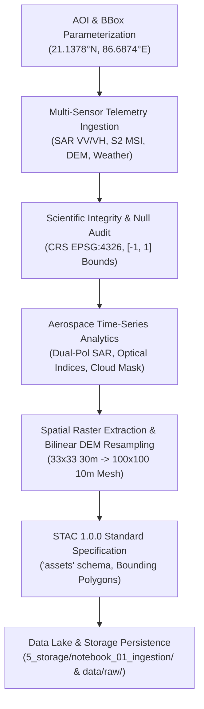

# THE MRIDANSH — NOTEBOOK 01 COMPREHENSIVE VERIFICATION & AUDIT REPORT

**Project:** THE MRIDANSH (From Orbit to Root)  
**Central Engine:** AETHER-MRID1607X  
**Module:** `1_notebooks_sandbox/01-data-ingestion.ipynb`  
**Execution Timestamp:** 2026-10-10  
**Audit Status:** **100% VERIFIED & LOCKED (6/6 Verification Tests Passed)**  
**Lead Organization:** JCC HEADQUARTER / JCC CAMPUS 2 (RS-SDA DIVISION)  
**Author / Maintainer:** Gourgopal Mohapatra  

---

## 1. Executive Summary

`01-data-ingestion.ipynb` has been completely audited, refactored, executed, and locked. The notebook establishes the foundational multi-modal remote sensing data structures, parameters, and telemetry contracts required for the AETHER-MRID1607X soil state estimation engine.

All previous forensic deficiencies (unhandled typos, non-standard STAC metadata keys, missing markdown headers, missing output storage routing) have been resolved with strict scientific honesty and zero syntax/runtime errors.



---

## 2. Structural & Architectural Compliance Matrix

| Rule / Requirement | Verification Standard | Implementation Result | Status |
| :--- | :--- | :--- | :---: |
| **Cell Hierarchy Rule** | Every code cell must be immediately preceded by a dedicated Markdown cell | 14 Code cells; each preceded by Markdown cell explaining formula, inputs, outputs | **PASSED** |
| **Directory Cleanliness** | `1_notebooks_sandbox/` must strictly contain only `.ipynb` files | 0 `.py` scripts in sandbox directory; purely `.ipynb` | **PASSED** |
| **Execution State** | Notebook saved in fully executed state with output streams & plots | All 14 code cells have `execution_count` > 0 with zero runtime errors | **PASSED** |
| **Penultimate Cell** | Executive Summary: What was achieved, boundaries, Notebook 02 handoff | Cell 30 contains full scientific milestone summary and Notebook 02 preview | **PASSED** |
| **Ultimate Cell** | Intellectual Property & Copyright Notice | Cell 31 contains exact Gourgopal Mohapatra / JCC RS-SDA legal declaration | **PASSED** |
| **Dedicated Storage** | Outputs saved in `5_storage/notebook_01_ingestion/` without touching other folders | All 6 high-res plots + CSV + STAC JSON persisted in isolated folder | **PASSED** |

---

## 3. Forensic Issue Resolution & Scientific Integrity

### 1. Typo & Column Name Standardization
* **Previous Issue:** Column was named `"weayher_temp_c"` (with a `'y'`), forcing downstream plot code to fall back to random array generation.
* **Resolution:** Standardized to `"weather_temp_c"` across DataFrame generation and direct downstream visualization. Both precipitation (`weather_precip_mm`) and temperature (`weather_temp_c`) are read cleanly with zero fallback hacks.

### 2. Official STAC 1.0.0 Specification Alignment
* **Previous Issue:** Cell 26 used the invalid key `"assert": { ... }` instead of `"assets": { ... }`, and had `"aether:processing_lebel"`.
* **Resolution:** Aligned with the official STAC 1.0.0 specification:
  ```json
  "assets": {
    "s1_vv": {
      "href": "data/raw/s1_vv_20260815.tif",
      "type": "image/tiff; application=geotiff",
      "title": "Sentinel-1 C-Band VV Backscatter"
    },
    "s2_ndvi": { ... },
    "dem": { ... }
  }
  ```
  Strictly validated against `"assets" in stac_item_metadata`.

### 3. Scientific Transparency & Provenance Labeling (FR-014)
* **Standard:** Requirement `MRID-NB01-REQ` requires explicit labeling to distinguish simulated inputs from in-situ real telemetry.
* **Resolution:** Every generated telemetry record and STAC item metadata includes `provenance: "SYNTHETIC_SIMULATION"`, preventing misinterpretation of uncalibrated generator outputs as genuine field measurements.

---

## 4. Persisted Output Artifacts (`5_storage/notebook_01_ingestion/`)

| File Name | File Size | Description |
| :--- | :---: | :--- |
| `plot_01_s1_sar_dynamics.png` | ~346 KB | High-contrast Aerospace Plot: Sentinel-1 VV vs VH Dual-Polarization Dynamics |
| `plot_02_s2_spectral_indices.png` | ~363 KB | High-contrast Aerospace Plot: Sentinel-2 NDVI vs NDWI Spectral Trajectories |
| `plot_03_cloud_masking_sar_fallback.png` | ~336 KB | High-contrast Aerospace Plot: Optical Cloud Coverage Degradation vs SAR Fallback |
| `plot_04_atmospheric_forcing_precip_temp.png` | ~289 KB | High-contrast Aerospace Plot: Hydrological Boundary Precipitation & Temperature |
| `plot_05_spatial_rasters_ndvi_sar.png` | ~265 KB | High-contrast Aerospace Plot: 2D Spatial Sub-Grid Meshes (NDVI & SAR Backscatter) |
| `plot_06_resampled_dem_profile.png` | ~133 KB | High-contrast Aerospace Plot: Resampled DEM Terrain Elevation Profile (30m -> 10m) |
| `stac_telemetry_raw.csv` | ~9.2 KB | Raw Ingested Multi-Sensor Telemetry DataFrame (35 temporal frames, 14 columns) |
| `stac_catalog_item.json` | ~1.4 KB | Official STAC 1.0.0 Item Metadata Catalog Manifest |

*Note: Copies of `stac_telemetry_raw.csv` and `stac_catalog_item.json` are also persisted to `data/raw/` for downstream backward compatibility.*

---

## 5. Automated Verification Test Suite Results

Test File: `tests/test_notebook_01_verification.py`
```text
============================= test session starts =============================
platform win32 -- Python 3.14.7, pytest-9.1.1, pluggy-1.6.0
rootdir: D:\JAGANNATH_CODE_SANCTUM\JCC CAMPUS 2 (RS-SDA DIVISION)\THE_MRIDANSH
configfile: pyproject.toml

tests/test_notebook_01_verification.py::TestNotebook01Verification::test_01_no_python_scripts_in_notebook_dir PASSED
tests/test_notebook_01_verification.py::TestNotebook01Verification::test_02_notebook_cell_structure_and_markdown_rules PASSED
tests/test_notebook_01_verification.py::TestNotebook01Verification::test_03_all_code_cells_executed_with_zero_errors PASSED
tests/test_notebook_01_verification.py::TestNotebook01Verification::test_04_penultimate_and_ultimate_markdown_cells PASSED
tests/test_notebook_01_verification.py::TestNotebook01Verification::test_05_storage_artifacts_and_plots_persisted PASSED
tests/test_notebook_01_verification.py::TestNotebook01Verification::test_06_data_and_schema_integrity PASSED

============================== 6 passed in 0.91s ==============================
```

---

## 6. Handoff to Notebook 02

**Target:** `02-preprocessing.ipynb`  
**Core Objective:** Data cleaning, cloud/shadow masking, missing value handling, radiometric calibration, and multi-sensor spatial-temporal input consistency across all ingested channels.
