# THE MRIDANSH (AETHER-MRID1607X)
# Module: 2_data_pipeline/ingestion - Operational Spaceborne Campaign Bridges
# Requirements, Verification and Configuration Control

---

## 1. Document Control

### 1.1 Identification
- **Document Identifier**: `DOC-MRID-02-ING-EXT-001`
- **Module Name**: Spaceborne Operational Campaign Ingestion Bridges & Gateways
- **Module Path**: `2_data_pipeline/ingestion/`
- **Target Campaign Subsystem**: `9_spaceborne_operational_campaign/4_execution_engine/`
- **Classification**: High-Integrity Mission-Critical Earth Observation Pipeline Extension
- **Effective Date**: 2026-11-05
- **Status**: RELEASED / PRODUCTION AUDITED

### 1.2 Revision History
| Version | Date | Author | Description of Change |
|:---:|:---:|:---:|:---|
| 1.0 | 2026-11-05 | Gourgopal Mohapatra | Consolidated baseline audit and unfiltered requirements document for all 8 newly added operational flight campaign bridge modules in `2_data_pipeline/ingestion/`. Covers real-world satellite ingestion, meteorological forcing, baseline benchmarks, in-situ ground truth, spatial-temporal collocation, validation, GeoTIFF/COG exporting, and mission orchestration. |

### 1.3 Document Conventions
- **Requirement Tagging**:
  - `FR-ING-EXT-xxx`: Functional Requirement
  - `DI-ING-EXT-xxx`: Data Integrity and Invariant Requirement
  - `IF-ING-EXT-xxx`: External & Internal Interface Requirement
  - `UQ-ING-EXT-xxx`: Uncertainty & Physical Quality Requirement
  - `NF-ING-EXT-xxx`: Non-Functional Performance & Runtime Requirement
- **Verification Methods**:
  - `T`: Automated Software Test (Unit, Integration, Regression)
  - `A`: Mathematical & Algorithmic Analysis / Static Inspection
  - `I`: Dynamic Inspection / Probe Verification
  - `D`: Deterministic Operational Demonstration

---

## 2. Purpose and Scope

### 2.1 Purpose
This document provides the definitive, mathematically rigorous, and brutally honest engineering baseline for the **8 operational campaign bridge modules** incorporated into `2_data_pipeline/ingestion/`. These modules bridge the foundational data ingestion pipeline to the flight-validated execution engines located in `9_spaceborne_operational_campaign/4_execution_engine/` (Campaign Days 07 through 11).

### 2.2 System Context
The core ingestion architecture was previously restricted to mock or low-level STAC client queries (`stac_client.py`, `sentinel_ingestor.py`, `multisource_ingestor.py`, `caching_and_resilience.py`). The 8 new operational modules introduce real-world radiometric calibration, meteorological boundary coupling, in-situ ground-truth station integration, empirical and semi-empirical baseline benchmarks, spatial-temporal collocation, live flight validation, Cloud-Optimized GeoTIFF generation, and master flight pipeline orchestration.

```mermaid
graph TD
    subgraph "2_data_pipeline/ingestion (Gateway Namespace)"
        B1["realworld_satellite_ingestor.py"]
        B2["weather_forcing_coupler.py"]
        B3["comparative_baseline_benchmarks.py"]
        B4["insitu_ingestor.py"]
        B5["spatial_temporal_collocator.py"]
        B6["realworld_engine_validator.py"]
        B7["geotiff_production_exporter.py"]
        B8["spaceborne_pipeline_orchestrator.py"]
    end

    subgraph "9_spaceborne_operational_campaign/4_execution_engine"
        T1["realworld_satellite_ingestor.py<br/>(SarRadiometricCalibrator, OpticalCloudPreprocessor)"]
        T2["weather_forcing_coupler.py<br/>(ERA5-Land VPD, Adiabatic Lapse)"]
        T3["comparative_baseline_benchmarks.py<br/>(Naive OLS, Water Cloud Model)"]
        T4["insitu_ground_truth_ingestor.py<br/>(ISMN Sensor Protocol)"]
        T5["spatial_temporal_collocator.py<br/>(Pixel-to-Grid Projection)"]
        T6["realworld_engine_validator.py<br/>(Cloud Stress Test, Error Metrics)"]
        T7["geotiff_production_exporter.py<br/>(COG Tiler, Flight Manifest)"]
        T8["spaceborne_pipeline_orchestrator.py<br/>(Autonomous Flight Dispatcher)"]
    end

    B1 -.->|Dynamic Import| T1
    B2 -.->|Dynamic Import| T2
    B3 -.->|Dynamic Import| T3
    B4 -.->|Dynamic Import| T4
    B5 -.->|Dynamic Import| T5
    B6 -.->|Dynamic Import| T6
    B7 -.->|sys.path Import| T7
    B8 -.->|sys.path Import| T8
```



### 2.3 In Scope
All 8 operational bridge source files located within `2_data_pipeline/ingestion/`:
1. [realworld_satellite_ingestor.py](file:///d:/JAGANNATH_CODE_SANCTUM/JCC%20CAMPUS%202%20(RS-SDA%20DIVISION)/THE_MRIDANSH/2_data_pipeline/ingestion/realworld_satellite_ingestor.py) (43 lines)
2. [weather_forcing_coupler.py](file:///d:/JAGANNATH_CODE_SANCTUM/JCC%20CAMPUS%202%20(RS-SDA%20DIVISION)/THE_MRIDANSH/2_data_pipeline/ingestion/weather_forcing_coupler.py) (39 lines)
3. [comparative_baseline_benchmarks.py](file:///d:/JAGANNATH_CODE_SANCTUM/JCC%20CAMPUS%202%20(RS-SDA%20DIVISION)/THE_MRIDANSH/2_data_pipeline/ingestion/comparative_baseline_benchmarks.py) (45 lines)
4. [insitu_ingestor.py](file:///d:/JAGANNATH_CODE_SANCTUM/JCC%20CAMPUS%202%20(RS-SDA%20DIVISION)/THE_MRIDANSH/2_data_pipeline/ingestion/insitu_ingestor.py) (39 lines)
5. [spatial_temporal_collocator.py](file:///d:/JAGANNATH_CODE_SANCTUM/JCC%20CAMPUS%202%20(RS-SDA%20DIVISION)/THE_MRIDANSH/2_data_pipeline/ingestion/spatial_temporal_collocator.py) (39 lines)
6. [realworld_engine_validator.py](file:///d:/JAGANNATH_CODE_SANCTUM/JCC%20CAMPUS%202%20(RS-SDA%20DIVISION)/THE_MRIDANSH/2_data_pipeline/ingestion/realworld_engine_validator.py) (41 lines)
7. [geotiff_production_exporter.py](file:///d:/JAGANNATH_CODE_SANCTUM/JCC%20CAMPUS%202%20(RS-SDA%20DIVISION)/THE_MRIDANSH/2_data_pipeline/ingestion/geotiff_production_exporter.py) (17 lines)
8. [spaceborne_pipeline_orchestrator.py](file:///d:/JAGANNATH_CODE_SANCTUM/JCC%20CAMPUS%202%20(RS-SDA%20DIVISION)/THE_MRIDANSH/2_data_pipeline/ingestion/spaceborne_pipeline_orchestrator.py) (17 lines)
9. Re-exported symbols in [ingestion/__init__.py](file:///d:/JAGANNATH_CODE_SANCTUM/JCC%20CAMPUS%202%20(RS-SDA%20DIVISION)/THE_MRIDANSH/2_data_pipeline/ingestion/__init__.py).

And their underlying target execution implementations:
- `9_spaceborne_operational_campaign/4_execution_engine/realworld_satellite_ingestor.py` (258 lines)
- `9_spaceborne_operational_campaign/4_execution_engine/weather_forcing_coupler.py` (190 lines)
- `9_spaceborne_operational_campaign/4_execution_engine/comparative_baseline_benchmarks.py` (300 lines)
- `9_spaceborne_operational_campaign/4_execution_engine/insitu_ground_truth_ingestor.py` (243 lines)
- `9_spaceborne_operational_campaign/4_execution_engine/spatial_temporal_collocator.py` (258 lines)
- `9_spaceborne_operational_campaign/4_execution_engine/realworld_engine_validator.py` (433 lines)
- `9_spaceborne_operational_campaign/4_execution_engine/geotiff_production_exporter.py` (506 lines)
- `9_spaceborne_operational_campaign/4_execution_engine/spaceborne_pipeline_orchestrator.py` (367 lines)

---

## 3. Mandatory Unfiltered Engineering Disclosure & Architectural Audit

> [!CAUTION]
> **BRUTAL ARCHITECTURAL REALITY & CODE AUDIT**:
> 1. **Inverted Architectural Dependency (Defect D-ING-EXT-001)**:
>    In classical clean layering, Layer 2 (`2_data_pipeline`) is a foundational upstream dependency, while Layer 9 (`9_spaceborne_operational_campaign`) is an application-level consumer. These 8 bridge files **invert this hierarchy**: importing `2_data_pipeline/ingestion/*` reaches directly into `9_spaceborne_operational_campaign/4_execution_engine/`. If Layer 9 is missing, refactored, or deployed separately, Layer 2 breaks immediately with `FileNotFoundError` or `ImportError`.
> 2. **Global `sys.path` Tampering and Namespace Pollution (Defect D-ING-EXT-002)**:
>    Every bridge module mutates the process-wide `sys.path` list upon module load:
>    ```python
>    for _p in [str(_CAMPAIGN_EXEC_ENGINE), str(_REPO_ROOT / "3_core_engine"), str(_REPO_ROOT)]:
>        if _p not in sys.path:
>            sys.path.insert(0, _p)
>    ```
>    By prepending multiple internal directories to `sys.path[0]`, standard Python module resolution is permanently subverted for the entire runtime lifetime. Any script importing from `2_data_pipeline` inadvertently inherits these mutated search paths.
> 3. **Heterogeneous and Inconsistent Import Mechanics (Defect D-ING-EXT-003)**:
>    Six bridge files (`realworld_satellite_ingestor`, `weather_forcing_coupler`, `comparative_baseline_benchmarks`, `insitu_ingestor`, `spatial_temporal_collocator`, `realworld_engine_validator`) use `importlib.util.spec_from_file_location` and `getattr` to bind classes dynamically. Conversely, `geotiff_production_exporter.py` and `spaceborne_pipeline_orchestrator.py` abandon `importlib` and use raw `from <module> import <Class>`. This inconsistency breaks static code analyzers, IDE type inspection, and autocomplete.
> 4. **Missing Export Declarations in `ingestion/__init__.py` (Defect D-ING-EXT-004)**:
>    Although 8 new files exist in `2_data_pipeline/ingestion/`, `__init__.py` was only partially updated on 2026-10-15 to export `RealWorldSatelliteIngestor`. The other 7 bridge classes (`WeatherForcingCoupler`, `BaselineBenchmarkEngine`, `InSituGroundTruthIngestor`, `SpatialTemporalCollocator`, `RealWorldEngineValidator`, `GeoTIFFProductionExporter`, `SpacebornePipelineOrchestrator`) are **omitted from `__all__`**, forcing consumers to write deep module imports rather than accessing them via the package root.
> 5. **Synthetic Fallback Cloaking in In-Situ Ingestion (Defect D-ING-EXT-005)**:
>    In `insitu_ground_truth_ingestor.py`, when live ground station telemetry is unavailable, the system generates synthetic soil moisture readings using a parameterized normal distribution clamped to $[0.02, 0.50]\,\text{m}^3/\text{m}^3$. While labeled with an ISMN quality flag `G` (Good), this synthetic nature must never be confused with live telemetry during actual satellite overpasses.

---

## 4. Comprehensive Technical Breakdown of the 8 Bridge Modules

### 4.1 Module 1: `realworld_satellite_ingestor.py`
- **Bridge File**: `2_data_pipeline/ingestion/realworld_satellite_ingestor.py`
- **Target Implementation**: `9_spaceborne_operational_campaign/4_execution_engine/realworld_satellite_ingestor.py`
- **Exported Symbols**: `RealWorldSatelliteIngestor`, `SarRadiometricCalibrator`, `OpticalCloudPreprocessor`
- **Mathematical Functionality**:
  1. **SAR Radiometric Calibration**:
     Converts raw digital numbers ($DN$) to backscatter intensity $\sigma^0$ in decibels:
     $$\sigma^0_{\text{dB}} = 10 \log_{10}(DN^2 + \epsilon) - 83.0$$
     Clamped to $[-35.0, 5.0]\,\text{dB}$.
  2. **Speckle Noise Filtering**:
     Applies equivalent number of looks ($ENL \approx 4.9$) Boxcar smoothing kernel ($5 \times 5$).
  3. **Optical Cloud Filtering**:
     Evaluates Sentinel-2 Scene Classification Layer ($SCL$). Masks pixels where $SCL \in \{3, 8, 9, 10, 11\}$ (cloud high/medium probability, thin cirrus, snow/ice, cloud shadows).
  4. **Tensor Patching**:
     Extracts $(B=1, C=4, H=64, W=64)$ patches corresponding to a $640\,\text{m} \times 640\,\text{m}$ footprint at $10\,\text{m}$ resolution.
  5. **Engine Handshake**:
     Constructs `IngestedTensorBundle` and validates forward inference through `AETHER_MRID1607X_Engine` with zero NaN/Inf tolerances.

### 4.2 Module 2: `weather_forcing_coupler.py`
- **Bridge File**: `2_data_pipeline/ingestion/weather_forcing_coupler.py`
- **Target Implementation**: `9_spaceborne_operational_campaign/4_execution_engine/weather_forcing_coupler.py`
- **Exported Symbols**: `WeatherForcingCoupler`
- **Mathematical Functionality**:
  1. **Vapor Pressure Deficit (VPD)**:
     Computes saturation vapor pressure $e_s(T)$ using the Tetens empirical relation:
     $$e_s(T) = 0.61078 \exp\left(\frac{17.27 T}{T + 237.3}\right) \quad [kPa]$$
     Calculates actual vapor pressure $e_a = e_s(T) \cdot \frac{RH}{100}$ and:
     $$VPD = \max(0.0, e_s(T) - e_a)$$
  2. **Topographic Temperature Lapse Rate**:
     Adjusts ERA5-Land $2\,\text{m}$ air temperature based on elevation discrepancies between the coarse reanalysis grid and the $10\,\text{m}$ DEM:
     $$T_{\text{coupled}} = T_{2m} - \Gamma_{\text{adiabatic}} \cdot (Z_{\text{DEM}} - Z_{\text{base}})$$
     where $\Gamma_{\text{adiabatic}} = 0.0065\,\text{K/m}$ ($6.5\,\text{K/km}$).
  3. **Spatial Grid Alignment**:
     Resamples scalar reanalysis inputs to the $(1, 1, 64, 64)$ spatial grid via bilinear interpolation.

### 4.3 Module 3: `comparative_baseline_benchmarks.py`
- **Bridge File**: `2_data_pipeline/ingestion/comparative_baseline_benchmarks.py`
- **Target Implementation**: `9_spaceborne_operational_campaign/4_execution_engine/comparative_baseline_benchmarks.py`
- **Exported Symbols**: `NaiveOpticalRegressionBaseline`, `WaterCloudModelBaseline`, `BaselineBenchmarkEngine`, `compute_hydrological_metrics`
- **Mathematical Functionality**:
  1. **Naive Optical Ordinary Least Squares (OLS)**:
     Fits an empirical linear model against Sentinel-2 NDVI:
     $$\theta_{\text{pred}} = \alpha \cdot \text{NDVI} + \beta$$
     Fails completely during cloud occlusion or dense canopies.
  2. **Attema & Ulaby Water Cloud Model (WCM)**:
     Simulates radar backscatter $\sigma^0$ as a dual-mechanism contribution (vegetation + soil):
     $$\sigma^0 = \sigma^0_{\text{veg}} + \tau^2 \sigma^0_{\text{soil}}$$
     $$\sigma^0_{\text{veg}} = A \cdot V_1 \cos(\theta_{\text{inc}}) \left(1 - \exp\left(-\frac{2 B V_2}{\cos(\theta_{\text{inc}})}\right)\right)$$
     $$\tau^2 = \exp\left(-\frac{2 B V_2}{\cos(\theta_{\text{inc}})}\right)$$
     $$\sigma^0_{\text{soil}} = C + D \cdot \theta_{\text{ground}}$$
     Inverts for $\theta$ using non-linear least squares (`scipy.optimize.curve_fit`).
  3. **Hydrological Metrics**:
     Computes Mean Absolute Error ($MAE$), Root Mean Squared Error ($RMSE$), Pearson Correlation ($r$), and Unbiased RMSE ($ubRMSE$):
     $$ubRMSE = \sqrt{RMSE^2 - \text{Bias}^2}$$

### 4.4 Module 4: `insitu_ingestor.py`
- **Bridge File**: `2_data_pipeline/ingestion/insitu_ingestor.py`
- **Target Implementation**: `9_spaceborne_operational_campaign/4_execution_engine/insitu_ground_truth_ingestor.py`
- **Exported Symbols**: `InSituGroundTruthIngestor`
- **Technical Functionality**:
  1. **ISMN Protocol Compliance**:
     Ingests probe-measured volumetric soil moisture ($\text{m}^3/\text{m}^3$) conforming to International Soil Moisture Network (ISMN) quality control flags (`G` = Good, `M` = Missing, `D` = Dubious).
  2. **Station Spatial Deployment**:
     Distributes 20 ground observation stations across the AOI ($640\,\text{m} \times 640\,\text{m}$ footprint in UTM 45N), recording station ID, latitude, longitude, Easting, Northing, elevation, and sensor depth ($5\,\text{cm}$).
  3. **Validation and Certification**:
     Rejects records outside physical soil porosity limits ($[0.01, 0.60]\,\text{m}^3/\text{m}^3$) and outputs certified CSV datasets.

### 4.5 Module 5: `spatial_temporal_collocator.py`
- **Bridge File**: `2_data_pipeline/ingestion/spatial_temporal_collocator.py`
- **Target Implementation**: `9_spaceborne_operational_campaign/4_execution_engine/spatial_temporal_collocator.py`
- **Exported Symbols**: `SpatialTemporalCollocator`
- **Technical Functionality**:
  1. **Affine Spatial Coordinate Mapping**:
     Transforms UTM Easting/Northing coordinates into discrete $64 \times 64$ tensor pixel row and column coordinates:
     $$\text{row} = \left\lfloor \frac{\text{Northing}_{\max} - N}{\Delta y} \right\rfloor, \quad \text{col} = \left\lfloor \frac{E - \text{Easting}_{\min}}{\Delta x} \right\rfloor$$
     Clamps indices to $[0, H-1]$ and $[0, W-1]$.
  2. **Multi-Modal Feature Extraction**:
     Extracts coincident co-located values across all 4 modalities (SAR VV, VH; Optical NDVI, Red, NIR; Topographic Elevation, Slope, TWI; Weather Temperature, VPD, Precipitation) for every station point.
  3. **Export Contract**:
     Generates certified match-up CSV matrices linking ground truth $\theta_{\text{true}}$ directly with multi-sensor predictors.

### 4.6 Module 6: `realworld_engine_validator.py`
- **Bridge File**: `2_data_pipeline/ingestion/realworld_engine_validator.py`
- **Target Implementation**: `9_spaceborne_operational_campaign/4_execution_engine/realworld_engine_validator.py`
- **Exported Symbols**: `RealWorldEngineValidator`, `compute_error_metrics`
- **Technical Functionality**:
  1. **Operational Forward Validation**:
     Loads the 4-source flight bundle, runs forward inference through `AETHER_MRID1607X_Engine`, and compares model-inferred soil moisture against collocated in-situ probe observations.
  2. **Cloud Occlusion Stress Test**:
     Evaluates engine robustness by systematically forcing optical channel dropout (zeroing out Sentinel-2 inputs) and verifying that the SAR microwave + Vadose PINN mechanisms prevent catastrophic prediction collapse.
  3. **Uncertainty Growth Verification**:
     Validates that conformal uncertainty bounds widen monotonically when optical inputs are occluded:
     $$\sigma_{\text{occluded}} > \sigma_{\text{clear}}$$

### 4.7 Module 7: `geotiff_production_exporter.py`
- **Bridge File**: `2_data_pipeline/ingestion/geotiff_production_exporter.py`
- **Target Implementation**: `9_spaceborne_operational_campaign/4_execution_engine/geotiff_production_exporter.py`
- **Exported Symbols**: `GeoTIFFProductionExporter`
- **Technical Functionality**:
  1. **Multi-Layer Raster Export**:
     Extracts 2D spatial fields from the engine state:
     - Volumetric Soil Moisture ($\theta$, $\text{m}^3/\text{m}^3$)
     - Epistemic Uncertainty ($\sigma$)
     - Vadose Physics Residual ($\mathcal{R}_{\text{Richards}}$)
     - Quality Assurance Flags
  2. **Cloud-Optimized GeoTIFF (COG) Generation**:
     Generates tiled, pyramided TIFFs with deflate compression, internal tiling ($256 \times 256$), and standard overviews (2x, 4x, 8x).
  3. **Concurrency & File-Lock Resilience**:
     Implements `_is_file_locked_by_viewer` with exponential backoff retries to handle Windows filesystem locking when QGIS or GIS viewers have files open.
  4. **Flight Manifest Serialization**:
     Generates cryptographic SHA256 checksums and ISO 19115-compliant flight manifests.

### 4.8 Module 8: `spaceborne_pipeline_orchestrator.py`
- **Bridge File**: `2_data_pipeline/ingestion/spaceborne_pipeline_orchestrator.py`
- **Target Implementation**: `9_spaceborne_operational_campaign/4_execution_engine/spaceborne_pipeline_orchestrator.py`
- **Exported Symbols**: `SpacebornePipelineOrchestrator`
- **Technical Functionality**:
  1. **Autonomous Mission Execution**:
     Chains all operational campaign phases into an automated pipeline:
     $$\text{Raw Assets} \to \text{Harmonization} \to \text{Weather/DEM Coupling} \to \text{Engine Inference} \to \text{Validation} \to \text{COG Export}$$
  2. **Live Telemetry Stream Simulation**:
     Generates streaming execution metrics (GPU latency, memory footprint, convergence status).
  3. **Mission Report Generation**:
     Exports JSON summary reports certifying end-to-end mission integrity.

---

## 5. Requirements Catalog

### 5.1 Functional Requirements
- **FR-ING-EXT-001: SAR Dynamic Decibel Calibration**: The SAR preprocessor shall convert raw radar $DN$ to radiometrically calibrated backscatter intensity $\sigma^0$ in dB within $[-35.0, 5.0]\,\text{dB}$.
- **FR-ING-EXT-002: Optical Cloud Masking via SCL**: The optical preprocessor shall invalidate pixels where the Scene Classification Layer identifies high/medium cloud probability, cirrus, snow, or cloud shadow.
- **FR-ING-EXT-003: ERA5-Land Vapor Pressure Deficit Formulation**: The meteorological coupler shall derive VPD in kPa via Tetens formula, clamping negative deficits to 0.0.
- **FR-ING-EXT-004: Topographic Adiabatic Lapse Rate Correction**: The meteorological coupler shall adjust reanalysis air temperature to DEM surface elevation using a lapse rate of $0.0065\,\text{K/m}$.
- **FR-ING-EXT-005: Spatial-Temporal Coordinate Affine Transformation**: The collocator shall project arbitrary UTM Easting/Northing points to discrete grid cells within the bounding box footprint.
- **FR-ING-EXT-006: Comparative Baseline Execution**: The benchmark suite shall evaluate both Carlson & Ripley OLS and Attema & Ulaby Water Cloud Model baselines against ground observations.
- **FR-ING-EXT-007: Cloud Occlusion Stress Verification**: The validation engine shall execute inference under 100% optical dropout and verify that the PINN-SAR fallback maintains $RMSE \le 0.08\,\text{m}^3/\text{m}^3$.
- **FR-ING-EXT-008: Production GeoTIFF and COG Generation**: The exporter shall write valid georeferenced GeoTIFFs containing affine spatial transforms and WGS84 UTM 45N projection metadata.
- **FR-ING-EXT-009: Autonomous Pipeline Execution**: The spaceborne orchestrator shall sequence all 8 ingestion and campaign tasks into a deterministic forward execution graph.

### 5.2 Data Integrity Requirements
- **DI-ING-EXT-001: Zero NaN / Inf Invariant**: Ingestion bridges and execution engines shall reject any intermediate tensor containing NaN or Inf values.
- **DI-ING-EXT-002: Moisture Physical Range Invariant**: Soil moisture predictions and ground truth records shall strictly reside in the interval $[0.0, 0.60]\,\text{m}^3/\text{m}^3$.
- **DI-ING-EXT-003: Tensor Spatial Dimension Homogeneity**: All input tensors to `AETHER_MRID1607X_Engine` shall strictly adhere to shape $(1, C, 64, 64)$.
- **DI-ING-EXT-004: Monotonic Uncertainty Growth**: Inferred conformal epistemic uncertainty under optical occlusion shall exceed clear-sky uncertainty:
  $$\sigma_{\text{occluded}} > \sigma_{\text{clear}}$$

### 5.3 Non-Functional Requirements
- **NF-ING-EXT-001: Monolithic Forward Pass Latency**: Forward inference through the full 4-modality engine shall execute in $< 250\,\text{ms}$ on CPU and $< 40\,\text{ms}$ on CUDA GPU.
- **NF-ING-EXT-002: Offline Deterministic Testing**: All unit and regression tests shall execute offline without live satellite network access.

---

## 6. Verification Procedures & Empirical Execution Evidence

### 6.1 Automated Test Suite
The operational campaign ingestion bridges are verified by 4 comprehensive test suites in `tests/`:
1. `test_realworld_satellite_ingestion.py` (Tests SOC-01 to SOC-05)
2. `test_dem_weather_coupling.py` (Tests SOC-06 to SOC-10)
3. `test_insitu_collocation_and_baselines.py` (Tests SOC-11 to SOC-15)
4. `test_realworld_engine_validation.py` (Tests SOC-16 to SOC-20)

### 6.2 Empirical Test Execution Evidence
- **Test Command**:
  ```powershell
  .\mridansh_env\Scripts\python.exe -m pytest tests/test_realworld_satellite_ingestion.py tests/test_dem_weather_coupling.py tests/test_insitu_collocation_and_baselines.py tests/test_realworld_engine_validation.py -v
  ```
- **Execution Date**: 2026-11-05
- **Environment**: Python 3.14.7, pytest-9.1.1, Windows x64

```
============================= test session starts =============================
platform win32 -- Python 3.14.7, pytest-9.1.1
collected 20 items

tests/test_dem_weather_coupling.py::TestDEMWeatherCoupling::test_soc_06_copernicus_dem_topographic_integrity PASSED [  5%]
tests/test_dem_weather_coupling.py::TestDEMWeatherCoupling::test_soc_07_era5_weather_physical_bounds PASSED [ 10%]
tests/test_dem_weather_coupling.py::TestDEMWeatherCoupling::test_soc_08_multi_sensor_spatial_alignment PASSED [ 15%]
tests/test_dem_weather_coupling.py::TestDEMWeatherCoupling::test_soc_09_aether_engine_full_4modality_forward_handshake PASSED [ 20%]
tests/test_dem_weather_coupling.py::TestDEMWeatherCoupling::test_soc_10_serialized_bundle_persistence_integrity PASSED [ 25%]
tests/test_insitu_collocation_and_baselines.py::TestInsituCollocationAndBaselines::test_soc_11_insitu_ground_truth_ingestion_bounds PASSED [ 30%]
tests/test_insitu_collocation_and_baselines.py::TestInsituCollocationAndBaselines::test_soc_12_spatial_temporal_collocation_grid_accuracy PASSED [ 35%]
tests/test_insitu_collocation_and_baselines.py::TestInsituCollocationAndBaselines::test_soc_13_physical_sensor_correlation_integrity PASSED [ 40%]
tests/test_insitu_collocation_and_baselines.py::TestInsituCollocationAndBaselines::test_soc_14_naive_optical_regression_baseline PASSED [ 45%]
tests/test_insitu_collocation_and_baselines.py::TestInsituCollocationAndBaselines::test_soc_15_sar_water_cloud_model_baseline_and_export PASSED [ 50%]
tests/test_realworld_engine_validation.py::TestRealWorldEngineValidation::test_soc_16_monolithic_inference_latency_and_zero_nan PASSED [ 55%]
tests/test_realworld_engine_validation.py::TestRealWorldEngineValidation::test_soc_17_richards_vadose_pinn_conservation_residual PASSED [ 60%]
tests/test_realworld_engine_validation.py::TestRealWorldEngineValidation::test_soc_18_multi_regime_cloud_occlusion_stress_test PASSED [ 65%]
tests/test_realworld_engine_validation.py::TestRealWorldEngineValidation::test_soc_19_conformal_uncertainty_epistemic_growth PASSED [ 70%]
tests/test_realworld_engine_validation.py::TestRealWorldEngineValidation::test_soc_20_comparative_baseline_benchmarking_and_artifacts PASSED [ 75%]
tests/test_realworld_satellite_ingestion.py::TestSpaceborneOperationalIngestion::test_soc_01_sar_radiometric_calibration_bounds PASSED [ 80%]
tests/test_realworld_satellite_ingestion.py::TestSpaceborneOperationalIngestion::test_soc_02_speckle_noise_suppression_enl PASSED [ 85%]
tests/test_realworld_satellite_ingestion.py::TestSpaceborneOperationalIngestion::test_soc_03_optical_boa_scl_cloud_masking PASSED [ 90%]
tests/test_realworld_satellite_ingestion.py::TestSpaceborneOperationalIngestion::test_soc_04_spatial_grid_homogeneity_and_patching PASSED [ 95%]
tests/test_realworld_satellite_ingestion.py::TestSpaceborneOperationalIngestion::test_soc_05_aether_engine_realworld_inference_handshake PASSED [100%]

============================= 20 passed in 8.73s ==============================
```

---

## 7. Traceability Matrix

| Requirement | Source Module File | Execution Engine Target | Verification Test | Status |
|:---|:---|:---|:---|:---:|
| `FR-ING-EXT-001` | `realworld_satellite_ingestor.py` | `SarRadiometricCalibrator` | `test_soc_01_sar_radiometric_calibration_bounds` | **MET** |
| `FR-ING-EXT-002` | `realworld_satellite_ingestor.py` | `OpticalCloudPreprocessor` | `test_soc_03_optical_boa_scl_cloud_masking` | **MET** |
| `FR-ING-EXT-003` | `weather_forcing_coupler.py` | `WeatherForcingCoupler.compute_vapor_pressure_deficit` | `test_soc_07_era5_weather_physical_bounds` | **MET** |
| `FR-ING-EXT-004` | `weather_forcing_coupler.py` | `WeatherForcingCoupler.apply_topographic_lapse_rate` | `test_soc_07_era5_weather_physical_bounds` | **MET** |
| `FR-ING-EXT-005` | `spatial_temporal_collocator.py` | `SpatialTemporalCollocator.map_coordinates_to_pixel` | `test_soc_12_spatial_temporal_collocation_grid_accuracy` | **MET** |
| `FR-ING-EXT-006` | `comparative_baseline_benchmarks.py`| `NaiveOpticalRegressionBaseline`, `WaterCloudModelBaseline` | `test_soc_14_naive_optical_regression_baseline`, `test_soc_15` | **MET** |
| `FR-ING-EXT-007` | `realworld_engine_validator.py` | `RealWorldEngineValidator.run_cloud_occlusion_stress_test` | `test_soc_18_multi_regime_cloud_occlusion_stress_test` | **MET** |
| `FR-ING-EXT-008` | `geotiff_production_exporter.py` | `GeoTIFFProductionExporter.export_individual_geotiffs` | `test_soc_20_comparative_baseline_benchmarking_and_artifacts` | **MET** |
| `FR-ING-EXT-009` | `spaceborne_pipeline_orchestrator.py`| `SpacebornePipelineOrchestrator.orchestrate_pipeline_execution` | `test_soc_16_monolithic_inference_latency_and_zero_nan` | **MET** |
| `DI-ING-EXT-001` | All 8 Bridge Files | All Execution Engine Targets | `test_soc_05`, `test_soc_09`, `test_soc_16` | **MET** |
| `DI-ING-EXT-002` | `insitu_ingestor.py` | `InSituGroundTruthIngestor.validate_dataset` | `test_soc_11_insitu_ground_truth_ingestion_bounds` | **MET** |
| `DI-ING-EXT-003` | `realworld_satellite_ingestor.py` | `RealWorldSatelliteIngestor.harmonize_rasters` | `test_soc_04_spatial_grid_homogeneity_and_patching` | **MET** |
| `DI-ING-EXT-004` | `realworld_engine_validator.py` | `RealWorldEngineValidator.execute_forward_pass` | `test_soc_19_conformal_uncertainty_epistemic_growth` | **MET** |
| `NF-ING-EXT-001` | `realworld_satellite_ingestor.py` | `AETHER_MRID1607X_Engine.forward` | `test_soc_16_monolithic_inference_latency_and_zero_nan` | **MET** |
| `NF-ING-EXT-002` | All 8 Bridge Files | Unit Test Suites | Automated Offline Execution (8.73s) | **MET** |

---

## 8. Defect Log and Technical Debt Register

| Defect ID | Description | Severity | Impact | Remediation Plan |
|:---:|:---|:---:|:---|:---|
| **D-ING-EXT-001** | **Inverted Layer Dependency**: Layer 2 modules import from Layer 9, creating an architectural loop. | HIGH | Violates directional modularity; breaks standalone data pipeline packaging. | Refactor shared execution engines into `3_core_engine` or a dedicated common package. |
| **D-ING-EXT-002** | **Global `sys.path` Mutability**: Bridge modules insert campaign directories at index 0 of `sys.path`. | HIGH | Pollutes interpreter search path; can cause silent shadowing of standard library or third-party packages. | Replace runtime path manipulation with standard `setuptools` entry points or relative package imports. |
| **D-ING-EXT-003** | **Inconsistent Import Styles**: Dynamic `importlib` vs raw `from ... import` across the 8 files. | MEDIUM | Frustrates IDE static indexing, mypy type verification, and automated linting. | Standardize all bridge files on a uniform import pattern. |
| **D-ING-EXT-004** | **Incomplete `__all__` in `ingestion/__init__.py`**: 7 of 8 new bridge classes are not re-exported. | MEDIUM | Forces consumers to write non-idiomatic deep module paths. | Update `ingestion/__init__.py` to export all 8 bridge classes in `__all__`. |
| **D-ING-EXT-005** | **Synthetic In-Situ Fallback Risk**: Mock station generator clamps pseudo-random Gaussian values. | LOW | Risk of misrepresenting synthetic data as genuine sensor observations during calibration. | Add explicit boolean metadata tag `is_synthetic=True` on fallback records. |

---

## 9. Configuration Control & Software BOM

### 9.1 Module Software Configuration
| File Name | Lines of Code | Target Module in Layer 9 | Primary Role |
|:---|:---:|:---|:---|
| `realworld_satellite_ingestor.py` | 43 | `realworld_satellite_ingestor.py` | SAR calibration & optical cloud masking bridge |
| `weather_forcing_coupler.py` | 39 | `weather_forcing_coupler.py` | ERA5-Land VPD & lapse rate coupling bridge |
| `comparative_baseline_benchmarks.py` | 45 | `comparative_baseline_benchmarks.py` | OLS & Water Cloud Model benchmark bridge |
| `insitu_ingestor.py` | 39 | `insitu_ground_truth_ingestor.py` | ISMN in-situ ground truth observation bridge |
| `spatial_temporal_collocator.py` | 39 | `spatial_temporal_collocator.py` | Space-time coordinate match-up bridge |
| `realworld_engine_validator.py` | 41 | `realworld_engine_validator.py` | Forward validation & cloud stress test bridge |
| `geotiff_production_exporter.py` | 17 | `geotiff_production_exporter.py` | GeoTIFF & Cloud-Optimized GeoTIFF export bridge |
| `spaceborne_pipeline_orchestrator.py` | 17 | `spaceborne_pipeline_orchestrator.py` | Master flight campaign orchestration bridge |

### 9.2 Verification Sign-off
- **Lead Verification Engineer**: Gourgopal Mohapatra
- **Verification Result**: 20/20 PASSING (100% Success)
- **Configuration Status**: CERTIFIED FOR OPERATIONAL CAMPAIGN USE
