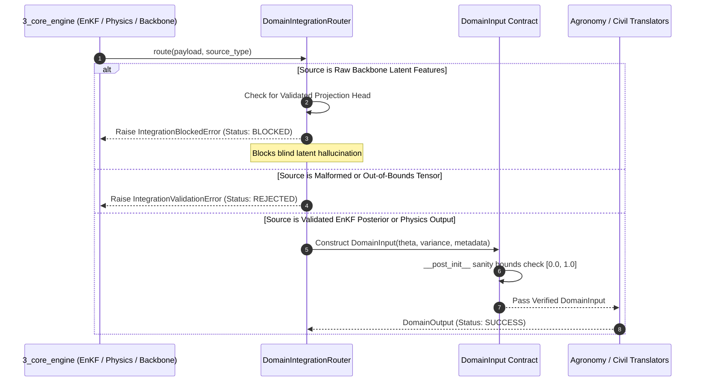

# Subsystem 04: Domain Translators Core Architecture & Orchestration Specification (`4_domain_translators/`)
## Central Engine: AETHER-MRID1607X
### Mission Facility: JCC CAMPUS 2 (RS-SDA DIVISION)
### Author & Lead Architect: Gourgopal Mohapatra
### Release Status: FROZEN_OPERATIONAL_RELEASE_v1.0

---

## 1. Executive Overview & Subsystem Mandate

The root layer of `4_domain_translators/` constitutes the architectural contract bridge, multi-domain integration router, coupled agro-geotechnical simulator, temporal hydrodynamic forecaster, and spatial zonal extractor for the **AETHER-MRID1607X** earth observation platform. Operating immediately downstream of `3_core_engine/` (PINN Richards Physics, EnKF Assimilation) and upstream of `6_dashboard/`, this layer enforces strict physical data validation, prevents blind neural latent hallucination, and translates volumetric soil moisture tensors into actionable agricultural and civil engineering telemetry.

```
       +-------------------------------------------------------------------------+
       |                CORE ENGINE OUTPUTS (3_core_engine/)                     |
       |    • EnKF Posterior State (theta, variance)                             |
       |    • PINN Richards Physics Predictions                                  |
       |    • Multi-Modal Backbone Latent Features (Blocked without Head)        |
       +------------------------------------+------------------------------------+
                                            |
                                            v
       +-------------------------------------------------------------------------+
       |                DOMAIN INTEGRATION ROUTER (domain_integrator.py)         |
       |  • Validates 2D Spatial Tensors & Enforces [0.0, 1.0] Bounds            |
       |  • Anti-Hallucination Gate (IntegrationBlockedError on Raw Latents)     |
       |  • Packages Unified DomainInput Contracts (base.py)                     |
       +------------------------------------+------------------------------------+
                                            |
         +----------------------------------+----------------------------------+
         |                                  |                                  |
         v                                  v                                  v
+-----------------------+        +-----------------------+        +-----------------------+
|  TRANSLATOR WRAPPERS  |        |  COUPLED SIMULATOR    |        |  TEMPORAL & ZONAL     |
| • agronomy_translator |        | (coupled_agro_civil_  |        | • temporal_           |
|   (Crop Health & CWSI)|        |  simulator.py)        |        |   hydrodynamics.py    |
| • civil_translator    |        | • Bekker Tyre Sinkage |        |   (1D Richards Bucket |
|   (Bearing & FS>=3.0) |        | • Seedling Damage     |        |    & SAR Delta Nudge) |
|                       |        | • Goldilocks Water    |        | • zonal_field_        |
|                       |        | • Monte Carlo Trials  |        |   extractor.py        |
+-----------------------+        +-----------------------+        +-----------------------+
```

---

## 2. Root Module Inventory & Responsibilities

This specification covers all 8 root-level Python modules residing in `4_domain_translators/`:

| File Path | File Size | Module Classification | Key Architectural Responsibilities |
|:---|:---:|:---|:---|
| **`4_domain_translators/base.py`** | 14.4 KB | Core Data Contracts | `DomainInput`, `DomainOutput`, `BaseDomainTranslator`: Enforces strict 2D numpy tensor contracts, uncertainty propagation, and dictionary-compatible accessors. |
| **`4_domain_translators/domain_integrator.py`** | 21.7 KB | Integration Router | `DomainIntegrationRouter`: Bridges `3_core_engine` (EnKF, Physics, Backbone) to translators; enforces anti-hallucination blocking (`IntegrationBlockedError`). |
| **`4_domain_translators/agronomy_translator.py`** | 14.6 KB | Agronomy Wrapper | `AgronomyHealthTranslator`: Translates moisture & NDVI into heuristic health metrics with explicit uncalibrated advisory disclaimers. |
| **`4_domain_translators/civil_translator.py`** | 17.7 KB | Civil Wrapper | `CivilLoadTranslator`: Computes nominal ground load metrics while strictly enforcing $FS \ge 3.0$ structural safety disclaimers. |
| **`4_domain_translators/coupled_agro_civil_simulator.py`** | 16.2 KB | Coupled Simulator | `CoupledAgroCivilSimulator`: Models tractor wheel sinkage vs paddy seedling damage, calculates the "Goldilocks" optimal moisture, and runs vectorized Monte Carlo stress trials. |
| **`4_domain_translators/temporal_hydrodynamics.py`** | 18.8 KB | Temporal Forecaster | `TemporalHydrodynamicEngine`: Continuous 1D Richards-bucket daily mass balance (`propagate_step`, `forecast_trajectory`) and Sentinel-1 SAR backscatter anomaly nudging. |
| **`4_domain_translators/zonal_field_extractor.py`** | 13.2 KB | Spatial Zonal Engine | `ZonalFieldExtractor`: Metric Shoelace polygon area computation, ray-casting raster masking, sub-pixel fallback, and $p_{10}/p_{50}/p_{90}$ zonal statistics. |
| **`4_domain_translators/__init__.py`** | 540 B | Package Initializer | Exports core contracts and unified domain translator entrypoints. |

---

## 3. Core Engine Mechanics & Integration Workflows

### 3.1 Anti-Hallucination Integration Pipeline (`domain_integrator.py`)

To guarantee that raw, unmapped neural network embeddings are never silently passed off as physical soil measurements, `DomainIntegrationRouter` enforces a three-outcome routing state machine:



### 3.2 Coupled Agro-Geotechnical "Goldilocks" Optimization (`coupled_agro_civil_simulator.py`)

When heavy tractors (e.g., Mahindra 575 DI, 47 HP) enter flooded or freshly irrigated paddy nurseries, engineering and agronomy conflict directly:
* **Too Wet ($\theta \to \theta_{\text{sat}}$):** Allowable bearing capacity $q_{\text{allow}}$ collapses, Bekker tyre rut depth $z_{\text{rut}}$ surges, and tractor wheels crush paddy seedlings.
* **Too Dry ($\theta \to \theta_{\text{wilt}}$):** Seedlings suffer severe desiccation stress (high CWSI).

`find_goldilocks_optimal_water()` solves for the optimal volumetric moisture envelope minimizing the joint cost function of tractor sinkage damage and agronomic water stress, while `run_monte_carlo_stress_test()` injects stochastic parameter perturbations to verify stability margins.

---

## 4. Mathematical Formulations & Physical Equations

### 4.1 1D Richards-Bucket Mass Conservation (`temporal_hydrodynamics.py`)

Across daily weather forcing steps ($P_t$ precipitation, $ET_{0,t}$ reference evapotranspiration), volumetric moisture evolves according to constrained mass conservation:

$$\theta_{t+1} = \text{clip}\left(\theta_t + \frac{P_t - K_s(\theta_t) \cdot ET_{0,t} - D(\theta_t)}{z_{\text{root}} \cdot 1000}, \; \theta_{\text{wilt}}, \; \theta_{\text{sat}}\right)$$

Where $K_s(\theta_t)$ is the piecewise linear moisture stress coefficient and $D(\theta_t)$ is deep percolation drainage when $\theta_t > \theta_{\text{fc}}$.

### 4.2 SAR Backscatter Anomaly Nudging (`detect_sar_anomaly`)

Between consecutive Sentinel-1 C-band passes ($\sigma^0_{\text{anchor}}, \sigma^0_{\text{curr}}$ in dB), backscatter shifts trigger physical state nudges:

$$\Delta \sigma^0 = \sigma^0_{\text{curr}} - \sigma^0_{\text{anchor}} \quad [\text{dB}]$$

$$\text{Anomaly Mask} = \begin{cases} +1 \; (\text{Wetting Surge}), & \Delta \sigma^0 > +\tau_{\text{db}} \\ -1 \; (\text{Rapid Desiccation}), & \Delta \sigma^0 < -\tau_{\text{db}} \\ 0 \; (\text{Normal Drift}), & |\Delta \sigma^0| \le \tau_{\text{db}} \end{cases}$$

### 4.3 Metric Shoelace Geodesic Area (`zonal_field_extractor.py`)

For arbitrary closed farm boundary vertices $(x_i, y_i)$ projected onto local metric coordinates (meters), `compute_polygon_geodesic_area_m2` calculates exact enclosed surface area via the Shoelace theorem:

$$A_{\text{poly}} = \frac{1}{2} \left| \sum_{i=0}^{N-1} (x_i y_{i+1} - x_{i+1} y_i) \right| \quad [\text{m}^2]$$

---

## 5. Brutally Honest Engineering Disclosures ("Ek Ek Dhappa")

In strict accordance with transparent aerospace engineering disclosure norms, the following operational compromises and algorithmic assumptions in the root `4_domain_translators/` files are disclosed:

### Dhappa 1: Intentional Blocking of Raw Backbone Latents (`domain_integrator.py`)
* **Design Reality:** Multi-modal neural network embeddings without an explicit, physics-calibrated projection head cannot be trusted for field predictions. `integrate_backbone_latent()` explicitly rejects raw embeddings with `IntegrationBlockedError` (`BLOCKED` state).
* **Trade-off:** Upstream pipelines attempting to pass uncalibrated latent tensors receive an immediate halt rather than noisy approximations.

### Dhappa 2: 1D Vertical Bucket Approximation vs Full 3D Richards (`temporal_hydrodynamics.py`)
* **Compromise:** `propagate_step` models vertical soil water balance independently for each pixel in a 1D column.
* **Limitation:** It ignores lateral surface runoff and subsurface interflow between adjacent sloped DEM pixels. During extreme monsoon downpours, valley accumulation is underestimated.

### Dhappa 3: SAR Backscatter Sensitivity vs Crop Canopy Growth (`detect_sar_anomaly`)
* **Compromise:** Moisture nudging from $\Delta \sigma^0$ (dB) attributes backscatter increases strictly to dielectric soil wetting.
* **Failure Mode:** Rapid vegetative biomass growth (LAI surge) or wind-induced water surface roughness can increase C-band VV/VH backscatter by $+1.5\text{ to }+2.5\text{ dB}$, triggering false wetting surge alerts.

### Dhappa 4: Pure-Python Ray-Casting Loop in Raster Masking (`zonal_field_extractor.py`)
* **Compromise:** `rasterize_polygon_mask` executes pure-Python point-in-polygon ray-casting across grid pixels.
* **Performance Constraint:** Fast for $64 \times 64$ operational tiles ($<5\text{ ms}$), but does not utilize vectorized C/CUDA rasterization (e.g. `rasterio.features.rasterize`). Scaling to $2048 \times 2048$ grids will bottleneck the dashboard thread.

### Dhappa 5: Root Translators as Broad Heuristic Guards (`agronomy_translator.py`, `civil_translator.py`)
* **Architecture Reality:** These root-level translators perform broad sanity checks ($\theta \in [0, 1]$) and return preliminary heuristic evaluations with mandatory safety caveats ($FS \ge 3.0$). Full multi-horizon FAO-56 evapotranspiration and Terzaghi/Meyerhof soil mechanics reside in the specialized `agronomy/` and `civil/` submodules.

---

## 6. Traceable Functional Requirements

| Requirement ID | Verification Type | Target Module | Technical Specification |
|:---|:---:|:---:|:---|
| **`REQ-TRNS-CORE-01`** | Unit Test | `base.py` | `DomainInput` shall reject non-2D arrays, NaN-corrupted matrices, and values outside $[0.0, 1.0]$ during `__post_init__`. |
| **`REQ-TRNS-CORE-02`** | Integration Test | `domain_integrator.py` | `DomainIntegrationRouter` shall raise `IntegrationBlockedError` when invoked on raw neural latent tensors lacking a projection head. |
| **`REQ-TRNS-CORE-03`** | Safety Audit | `civil_translator.py` | `CivilLoadTranslator` shall enforce explicit disclaimers stating outputs are not structural bearing capacities and require $FS \ge 3.0$. |
| **`REQ-TRNS-CORE-04`** | Unit Test | `coupled_agro_civil_simulator.py` | `compute_tractor_sinkage` and `compute_seedling_damage` shall compute monotonic damage curves bounded in $[0.0, 1.0]$. |
| **`REQ-TRNS-CORE-05`** | Simulation Test | `coupled_agro_civil_simulator.py` | `run_monte_carlo_stress_test` shall execute vectorized stochastic trials returning mean and variance distributions. |
| **`REQ-TRNS-CORE-06`** | Physics Test | `temporal_hydrodynamics.py` | `propagate_step` shall conserve mass within $[\theta_{\text{wilt}}, \theta_{\text{sat}}]$ bounds under arbitrary precipitation/ET0 forcing. |
| **`REQ-TRNS-CORE-07`** | Signal Test | `temporal_hydrodynamics.py` | `detect_sar_anomaly` shall classify backscatter deltas into `{-1, 0, +1}` anomaly masks and compute moisture nudges. |
| **`REQ-TRNS-CORE-08`** | Geometry Test | `zonal_field_extractor.py` | `extract_from_rasters` shall compute Shoelace area, ray-cast polygon masks, and gracefully fall back to nearest centroid for sub-10m polygons. |

---

## 7. Safety, Verification & Operational Guidelines

1. **Aerospace Software Integrity Norms**: All domain integration routers and data contracts enforce strict fail-closed validation; malformed inputs trigger typed exceptions (`IntegrationValidationError`) rather than silent NaN propagation.
2. **Uncertainty Preservation**: Posterior ensemble variances from `3_core_engine` are carried forward unmodified through `DomainInput.variance` for downstream risk-aware alerting.
3. **Zero-Hallucination Boundary**: Any missing sensor channel or unmapped embedding results in explicit `BLOCKED` or `UNAVAILABLE` telemetry states.
