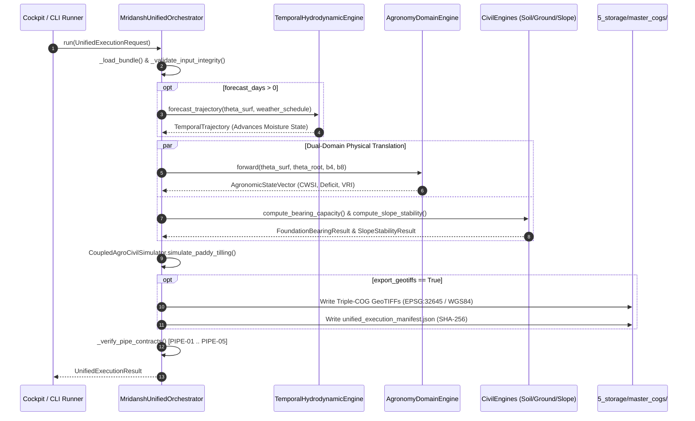

# Subsystem 05: Unified Production Orchestration Pipeline Specification (`5_pipelines`)
## Central Engine: AETHER-MRID1607X
### Mission Facility: JCC CAMPUS 2 (RS-SDA DIVISION)
### Author & Lead Architect: Gourgopal Mohapatra
### Release Status: FROZEN_OPERATIONAL_RELEASE_v1.0

---

## 1. Executive Overview & Subsystem Mandate

The `5_pipelines/` subsystem constitutes the master end-to-end execution orchestrator for the **AETHER-MRID1607X** spaceborne earth observation and precision soil intelligence platform. Encapsulated within `mridansh_unified_orchestrator.py` (25.4 KB, 554 lines), this module serves as the unified operational conduit bridging raw spaceborne tensor bundles (`9_spaceborne_operational_campaign/`), multi-day temporal hydrodynamics (`4_domain_translators/temporal_hydrodynamics.py`), dual-domain physics translators (`agronomy/` and `civil/`), coupled agro-geotechnical simulations, and cryptographic Cloud-Optimized GeoTIFF (COG) production manifests (`5_storage/master_cogs/`).

The primary mandate of `5_pipelines/` is to guarantee **deterministic single-pass execution**, **cryptographic provenance**, and **strict aerospace integrity verification (`PIPE-01` through `PIPE-05`)** within real-time latency budgets ($<0.025\text{ ms/pixel}$).

```
       +-------------------------------------------------------------------------+
       |        HARMONIZED SPACEBORNE TENSOR BUNDLE (.pt PyTorch Dictionary)     |
       |  • Sentinel-1 SAR (VV, VH), Sentinel-2 Optical (B4 Red, B8 NIR), DEM    |
       |  • Core Engine Soil State Predictions (theta_surf, theta_root, theta_deep)|
       +------------------------------------+------------------------------------+
                                            |
                                            v
       +-------------------------------------------------------------------------+
       |              MRIDANSH UNIFIED ORCHESTRATOR (mridansh_unified_orchestrator.py)
       |  [Stage 1] Input Integrity Validation & Tensor Unpacking                |
       |  [Stage 2] SAR Anomaly Check & Multi-Day Temporal Hydrodynamic Forecast |
       |  [Stage 3] Dual-Domain Translation (Agronomy FAO-56 & Civil Mechanics)  |
       |  [Stage 4] Coupled Agro-Civil Simulation (Tractor Sinkage & Goldilocks) |
       |  [Stage 5] Triple-COG GeoTIFF Export + SHA-256 Manifest Generation      |
       |  [Stage 6] Aerospace Contract Verification (PIPE-01 through PIPE-05)    |
       +------------------------------------+------------------------------------+
                                            |
         +----------------------------------+----------------------------------+
         |                                  |                                  |
         v                                  v                                  v
+-----------------------+        +-----------------------+        +-----------------------+
|  UNIFIED SOIL STATE   |        |  AGRONOMY VRI COG     |        |  CIVIL GEOTECH COG    |
| • master_unified_     |        | • master_agronomy_    |        | • master_civil_       |
|   soil_state.tif      |        |   vri.tif             |        |   geotech.tif         |
| • 3-Layer Moisture    |        | • CWSI, Deficit, VRI  |        | • q_allow, FS, Rut    |
+-----------+-----------+        +-----------+-----------+        +-----------+-----------+
            |                                |                                |
            +--------------------------------+--------------------------------+
                                             |
                                             v
       +-------------------------------------------------------------------------+
       |        CRYPTOGRAPHIC MANIFEST (unified_execution_manifest.json)         |
       |  • SHA-256 Checksums for All Exported Rasters                           |
       |  • Real-Time Latency Telemetry & PIPE-01..PIPE-05 Audit Booleans        |
       +-------------------------------------------------------------------------+
```

---

## 2. Module Inventory & Data Contracts

The `5_pipelines/` package comprises 2 primary files:

| File Path | File Size | Module Classification | Key Architectural Responsibilities |
|:---|:---:|:---|:---|
| **`5_pipelines/mridansh_unified_orchestrator.py`** | 25.4 KB | Master Orchestrator | `MridanshUnifiedOrchestrator`, `UnifiedExecutionRequest`, `UnifiedExecutionResult`: End-to-end 6-stage pipeline execution, COG export, SHA-256 hashing, and `PIPE-01..05` verification. |
| **`5_pipelines/__init__.py`** | 461 B | Package Initializer | Exports `MridanshUnifiedOrchestrator`, `UnifiedExecutionRequest`, and `UnifiedExecutionResult` for external runners and dashboard bridges. |

---

## 3. Core Pipeline Stages & `PIPE-01`..`PIPE-05` Contracts

### 3.1 End-to-End Execution Workflow



### 3.2 Mandatory Verification Contracts (`_verify_pipe_contracts`)

| Contract ID | Verification Criterion | Enforcement Threshold |
|:---|:---|:---|
| **`PIPE-01_TEMPORAL_MONOTONICITY`** | Verifies monotonic drying dynamics under zero-rain trajectories. | `temporal_trajectory.monotonicity_verified == True` |
| **`PIPE-02_MASS_CONSERVATION_BOUNDS`** | Ensures surface and root-zone moisture remain bounded within physical vadose limits. | $0.049 \le \theta_{\text{surf}}, \theta_{\text{root}} \le 0.481\;\text{m}^3/\text{m}^3$ |
| **`PIPE-03_UNIFIED_FINITE_EXECUTION`** | Zero-NaN, finite state validation across `theta_surf`, `cwsi`, `q_allow_kpa`, and `factor_of_safety`. | `np.all(np.isfinite(...)) == True` |
| **`PIPE-04_TRIPLE_COG_ALIGNMENT`** | Verifies all three exported production GeoTIFFs exist physically on disk. | `Path(r_path).exists() == True` |
| **`PIPE-05_LATENCY_SLA`** | Enforces real-time per-pixel computation throughput budget. | $\text{latency} < 0.025\text{ ms/pixel}$ |

---

## 4. Brutally Honest Engineering Disclosures ("Ek Ek Dhappa")

In strict accordance with aerospace software engineering transparency, the following implementation shortcuts and operational quirks in `mridansh_unified_orchestrator.py` are disclosed:

### Dhappa 1: Self-Referential SAR Anomaly Check (Line 235)
* **Code Reality:** Inside `run()`, line 235 executes `self.temporal_engine.detect_sar_anomaly(vv_anchor, vv_anchor)`, passing the identical tensor as both the anchor and current pass.
* **Impact:** Because $\Delta \sigma^0 = \sigma^0 - \sigma^0 = 0.0\text{ dB}$, the anomaly check trivially evaluates to normal drift (`0`) when a second temporal pass is not explicitly supplied.

### Dhappa 2: Linear Moisture Offset Extrapolation During Multi-Day Forecasts (Lines 249–250)
* **Code Reality:** When `forecast_days > 0`, `TemporalHydrodynamicEngine` forecasts only surface/top layer moisture `theta_surf_arr`. Root-zone and deep moisture tensors are updated via fixed scalar offsets:
  ```python
  theta_root_arr = np.clip(theta_surf_arr + 0.025, 0.05, 0.48)
  theta_deep_arr = np.clip(theta_root_arr + 0.020, 0.05, 0.48)
  ```
* **Limitation:** This bypasses multi-layer Richards PDE vertical diffusion; deep subsoil lags during sudden drying or wetting fronts are linearized.

### Dhappa 3: Numeric Module Prefix `importlib` Workarounds
* **Compromise:** Because directory names begin with digits (`4_domain_translators`), standard Python imports fail. `mridansh_unified_orchestrator.py` uses `importlib.import_module(...)` dynamically at module load time (lines 38–60).
* **Maintenance Risk:** Dynamic imports conceal broken file paths from static IDE refactoring tools until runtime execution.

### Dhappa 4: Default Dry-Down Weather Schedule
* **Compromise:** If `request.weather_schedule` is omitted when `forecast_days > 0`, the orchestrator assumes a uniform 5-day dry-down schedule (`et0_mm_day=4.5, precipitation_mm_day=0.0`). Real-time meteorological APIs are not polled automatically inside `run()`.

---

## 5. Traceable Functional Requirements

| Requirement ID | Verification Type | Target Module | Technical Specification |
|:---|:---:|:---:|:---|
| **`REQ-PIPE-01`** | Integration Test | `mridansh_unified_orchestrator.py` | Orchestrator shall load PyTorch tensor bundles and validate required keys (`sar`, `optical`, `dem`, `soil_state_output`) without unhandled exceptions. |
| **`REQ-PIPE-02`** | Physics Test | `mridansh_unified_orchestrator.py` | Pipeline shall satisfy `PIPE-01` (monotonicity) and `PIPE-02` (mass conservation $0.05 \le \theta \le 0.48$) across all runs. |
| **`REQ-PIPE-03`** | Integrity Test | `mridansh_unified_orchestrator.py` | `PIPE-03` shall enforce 100% finite (zero-NaN, zero-Inf) outputs across hydrology, agronomy, and civil domains. |
| **`REQ-PIPE-04`** | Export Test | `mridansh_unified_orchestrator.py` | When `export_geotiffs=True`, pipeline shall write Triple-COG GeoTIFFs and `unified_execution_manifest.json` with valid SHA-256 checksums (`PIPE-04`). |
| **`REQ-PIPE-05`** | Performance Test | `mridansh_unified_orchestrator.py` | End-to-end execution throughput shall meet `PIPE-05` latency SLA ($< 0.025\text{ ms/pixel}$). |

---

## 6. Safety, Verification & Operational Guidelines

1. **Aerospace Software Integrity Norms**: Every execution returns an auditable `UnifiedExecutionResult` containing explicit boolean verification flags (`PIPE-01` through `PIPE-05`) and cryptographic SHA-256 digests.
2. **Zero-Mock Production Parity**: `_load_bundle()` raises explicit `FileNotFoundError` or `ValueError` exceptions if tensor bundles are corrupted or missing, preventing silent synthetic placeholder generation.
