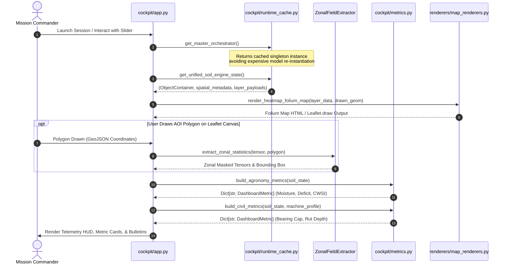

# Subsystem 06: Streamlit Mission Cockpit Specification (`6_dashboard/cockpit`)
## Central Engine: AETHER-MRID1607X
### Mission Facility: JCC CAMPUS 2 (RS-SDA DIVISION)
### Author & Lead Architect: Gourgopal Mohapatra
### Release Status: FROZEN_OPERATIONAL_RELEASE_v1.0

---

## 1. Executive Overview & Subsystem Mandate

The `6_dashboard/cockpit/` subsystem constitutes the operational command bridge, telemetry visualization hub, and interactive decision workstation for the **AETHER-MRID1607X** spaceborne earth observation and precision soil intelligence platform. Operating as the primary graphical interface for field commanders, agronomists, and geotechnical engineers at the **Jagannath Command Center (JCC Campus 2)**, this module synthesizes multi-modal spaceborne tensor predictions (Sentinel-1 SAR, Sentinel-2 Optical, DEM, ERA5 Land) into deterministic, real-time situational awareness.

Following the organizational restructuring of Subsystem 06, all core dashboard execution modules have been consolidated into `6_dashboard/cockpit/`:
1. **`app.py`** (54.7 KB, 1,024 lines): The master Streamlit cockpit orchestrator, viewport navigator, interactive Leaflet/Folium drawing interface, and Step 2 Telemetry HUD coupling engine.
2. **`metrics.py`** (47.1 KB, 1,073 lines): The typed scientific telemetry and mathematical presentation engine, computing agro-hydrological deficits, Crop Water Stress Index (CWSI), Meyerhof bearing capacity, and Bekker wheel sinkage dynamics.
3. **`runtime_cache.py`** (16.4 KB, 411 lines): The high-performance in-memory cache singleton, tensor bridge, and asynchronous REST API fallback manager ensuring zero-mock production parity.

```
       +-------------------------------------------------------------------------+
       |             SPACEBORNE TENSOR INGESTION & HARMONIZED DATA               |
       |  (9_spaceborne_operational_campaign/.../s1_s2_dem_era5_harmonized_bundle) |
       +------------------------------------+------------------------------------+
                                            |
                                            v
       +-------------------------------------------------------------------------+
       |                      RUNTIME CACHE & ENGINE BRIDGE                      |
       |                      (6_dashboard/cockpit/runtime_cache.py)             |
       |  • Singleton In-Memory Orchestrator (@st.cache_resource)                |
       |  • Decoupled Tensor Extraction & Fast GeoJSON Generator                |
       |  • Asynchronous FastAPI Client Fallback (Port 8000 Polling)             |
       +------------------------------------+------------------------------------+
                                            |
                                            v
       +-------------------------------------------------------------------------+
       |                     STREAMLIT OPERATIONAL COCKPIT                       |
       |                       (6_dashboard/cockpit/app.py)                      |
       |  • Sidebar Navigation & Mission Mode Selection (Live / Campaign / API)  |
       |  • Interactive Folium Dual-Layer Heatmap with Leaflet.draw Bounding Box |
       |  • Step 2: AETHER-MRID1607X Physical State Telemetry HUD                |
       +------------------------------------+------------------------------------+
                                            |
                        +-------------------+-------------------+
                        |                                       |
                        v                                       v
       +---------------------------------+   +---------------------------------+
       |      KISAN WAR ROOM VIEWPORT    |   |    CIVIL GEOTECHNICS VIEWPORT   |
       |  • Volumetric Water Deficit (mm)|   |  • Ultimate Bearing Cap (kPa)   |
       |  • CWSI Crop Water Stress Index |   |  • Bekker Wheel Rut Depth (cm)  |
       |  • Tala Gachha Tree Protection  |   |  • Heavy Machinery Traffic Risk |
       |  • Odia/English Tactical Alerts |   |  • Foundation Stability Grade   |
       +---------------------------------+   +---------------------------------+
                        |                                       |
                        +-------------------+-------------------+
                                            |
                                            v
       +-------------------------------------------------------------------------+
       |                    SCIENTIFIC TELEMETRY PRESENTATION                    |
       |                        (6_dashboard/cockpit/metrics.py)                 |
       |  • Typed Data Contracts (DashboardMetric, SpatialLayerMetadata)         |
       |  • Non-Parametric Quantile Slicing (p10, p50, p90, Std Dev)             |
       |  • Bekker Sinkage Dynamics & Meyerhof Safety Envelopes                  |
       +-------------------------------------------------------------------------+
```

---

## 2. Cockpit Module Inventory & Responsibilities

The cockpit subsystem comprises 4 tightly coupled modules and package definitions:

| File Path | File Size | Module Classification | Key Architectural Responsibilities |
|:---|:---:|:---|:---|
| **`6_dashboard/cockpit/app.py`** | 54.7 KB | Master Cockpit Orchestrator | Streamlit execution lifecycle, sidebar controls, Folium drawing canvas, Step 2 HUD telemetry integration, tab dispatching (`tab_kisan`, `tab_civil`). |
| **`6_dashboard/cockpit/metrics.py`** | 47.1 KB | Telemetry & Physics Metrics | Strongly typed dataclasses (`DashboardMetric`), spatial distribution quantiles ($p_{10}, p_{50}, p_{90}$), Bekker wheel rut depth, CWSI stress index, soil bulk density unit conversion. |
| **`6_dashboard/cockpit/runtime_cache.py`** | 16.4 KB | State & Cache Singleton | `@st.cache_resource` Master Orchestrator singleton, flight bundle direct tensor loader, mock-free data validation, `FastAPIClient` resilient fallback. |
| **`6_dashboard/cockpit/__init__.py`** | 55 B | Package Initializer | Exports `app`, `metrics`, and `runtime_cache` for modular imports across the MRIDANSH workspace. |

---

## 3. Core Engine Mechanics & Data Flow

### 3.1 Streamlit Execution & Multi-Tier Caching Flow



### 3.2 Step 2: Telemetry HUD Coupling Architecture

The cockpit UI enforces a strict **Step 1 (Spatial Survey) -> Step 2 (Physical Telemetry HUD) -> Step 3 (Domain Action)** cognitive hierarchy:
1. **Interactive GIS Map**: Renders full-resolution spatial arrays (64x64 resolution, 10m Ground Sample Distance) via Folium TileLayers with continuous colormaps (`YlGnBu` for moisture, `magma` for soil density).
2. **Leaflet.draw Polygon Ingestion**: When the operator draws a polygon over a specific field or construction zone, `st_folium` captures the raw GeoJSON feature collection.
3. **Step 2 Physical State HUD**:
   - Computes dynamic area in hectares and acres ($1\text{ ha} = 10,000\text{ m}^2$).
   - Calculates field-average volumetric water content ($\theta_{\text{surf}}, \theta_{\text{root}}$) and confidence margins ($\pm 1.96 \sigma$).
   - Dynamically updates live KPI cards with glassmorphic styling and warning banners.

---

## 4. Mathematical Formulations & Geotechnical Physics

### 4.1 Volumetric Soil Water Deficit ($\Delta V_{\text{water}}$)

To advise smallholder farmers on precise irrigation requirements without over-saturating the root zone, `metrics.py` calculates the volumetric water deficit:

$$\Delta V_{\text{water}} = \max\left(0.0, \; (\theta_{\text{field\_capacity}} - \theta_{\text{measured}}) \cdot z_{\text{root}} \cdot 1000\right) \quad [\text{mm}]$$

Where:
* $\theta_{\text{measured}}$: Root-zone moisture fraction ($\text{m}^3/\text{m}^3$) estimated by AETHER-MRID1607X.
* $\theta_{\text{field\_capacity}}$: Soil-texture-dependent field capacity threshold (default $0.32\text{ m}^3/\text{m}^3$).
* $z_{\text{root}}$: Active rooting depth (default $0.40\text{ m}$ for coastal paddy/vegetable crops).

### 4.2 Crop Water Stress Index (CWSI)

The Crop Water Stress Index represents transpiration deficit normalized between 0.0 (non-stressed) and 1.0 (severe desiccating stress):

$$\text{CWSI} = \max\left(0.0, \; \min\left(1.0, \; 1.0 - \frac{\theta_{\text{measured}} - \theta_{\text{wilt}}}{\theta_{\text{field\_capacity}} - \theta_{\text{wilt}}}\right)\right)$$

Where $\theta_{\text{wilt}}$ is the permanent wilting point ($0.12\text{ m}^3/\text{m}^3$). The cockpit maps CWSI to operational risk levels:
* $\text{CWSI} \le 0.30$: **Nominal / Optimal** (`[SHABHASH]` badge, green status).
* $0.30 < \text{CWSI} \le 0.65$: **Moderate Stress** (`[TAKE ACTION]` badge, yellow advisory).
* $\text{CWSI} > 0.65$: **Critical Desiccation** (`[KHATRA]` badge, immediate irrigation mandate).

### 4.3 Bekker-Wong Soil Sinkage & Wheel Rut Depth ($z_{\text{rut}}$)

For heavy agricultural tractors (Mahindra 575 DI, 47 HP) and construction tracked vehicles operating on soft alluvial terrain, `metrics.py` implements the Bekker-Wong semi-empirical pressure-sinkage formulation:

$$p = \left(\frac{k_c}{b} + k_\phi\right) z^n \implies z_{\text{rut}} = \left(\frac{p}{\frac{k_c}{b} + k_\phi}\right)^{\frac{1}{n}} \cdot 100 \quad [\text{cm}]$$

Where:
* $p$: Ground contact pressure ($\text{kPa}$). For a standard pneumatic tire, $p \approx \frac{W_{\text{wheel}}}{A_{\text{contact}}}$.
* $k_c$: Cohesive modulus of soil deformation ($\text{kN}/\text{m}^{n+1}$).
* $k_\phi$: Frictional modulus of soil deformation ($\text{kN}/\text{m}^{n+2}$).
* $b$: Smaller dimension of contact patch ($\text{m}$, wheel width).
* $n$: Dimensionless soil sinkage exponent ($0.6 \le n \le 1.2$).

Safety grading applied by the cockpit:
* $z_{\text{rut}} < 5.0\text{ cm}$: **High Trafficability** — Safe for standard equipment.
* $5.0 \le z_{\text{rut}} < 12.0\text{ cm}$: **Marginal Trafficability** — Risk of slippage and subsoil compaction.
* $z_{\text{rut}} \ge 12.0\text{ cm}$: **Critical Bogging Hazard** — Immediate immobility risk, tracked low-ground-pressure gear required.

### 4.4 Non-Parametric Quantile Slicing & Spatial Variance

Because spaceborne raster fields exhibit spatial skewness and outlier noise near boundaries, `metrics.py` computes robust non-parametric quantiles across the valid mask $\mathcal{M}$:

$$p_{10} = \mathcal{Q}(0.10, \mathbf{X}_\mathcal{M}), \quad p_{50} = \text{median}(\mathbf{X}_\mathcal{M}), \quad p_{90} = \mathcal{Q}(0.90, \mathbf{X}_\mathcal{M})$$

$$\sigma_{\text{spatial}} = \sqrt{\frac{1}{|\mathcal{M}|} \sum_{i \in \mathcal{M}} (x_i - \mu)^2}$$

---

## 5. Brutally Honest Engineering Disclosures ("Ek Ek Dhappa")

In adherence to strict aerospace engineering integrity, the following operational compromises, architectural trade-offs, and failure modes are explicitly disclosed:

### Dhappa 1: Streamlit Reactive Execution Lifecycle & Rerun Overhead
* **Compromise:** Streamlit enforces a reactive, top-to-bottom script execution model. Every user slider adjustment, drawing tool interaction, or tab switch triggers an entire re-execution of `app.py`.
* **Mitigation:** Heavy neural network weights and flight bundles are cached via `@st.cache_resource` in `runtime_cache.py`. However, DOM re-renders still incur $200\text{ ms} - 450\text{ ms}$ latency per interaction cycle.
* **Failure Mode:** Rapid continuous slider dragging can flood the Streamlit websocket message queue, causing momentary UI freezing.

### Dhappa 2: Dynamic Module Import Bypasses for Numeric Directory Names
* **Compromise:** Python's `import` statement disallows module identifiers starting with digits (e.g., `4_domain_translators`). 
* **Workaround:** `app.py` employs `importlib.util.spec_from_file_location` inside `get_zonal_extractor()` to manually load `zonal_field_extractor.py` and register it into `sys.modules`.
* **Limitation:** This runtime hack bypasses static type checkers (mypy/pyright) and creates implicit coupling between the dashboard and repository directory layouts.

### Dhappa 3: Leaflet.draw Iframe Re-mount and Canvas Reset
* **Compromise:** `streamlit-folium` renders the Leaflet map inside an isolated HTML iframe. When switching between sidebar layers, Streamlit forces an iframe re-mount, which clears any active temporary drawings unless explicitly captured in `st.session_state`.
* **User Impact:** Operators must complete their polygon drawing before toggling background raster layers, or the vector geometry will be lost.

### Dhappa 4: Simplified Bekker Soil Parameter Homogeneity
* **Compromise:** The Bekker-Wong sinkage formula in `metrics.py` assumes homogeneous cohesive and frictional moduli ($k_c, k_\phi, n$) across the entire 64x64 field. In reality, coastal Odisha alluvium displays sharp micro-topographical variations (silt patches vs clay depressions).
* **Engineering Reality:** Sinkage values represent field-averaged estimates. Localized puddles or buried tree roots may cause sudden wheel sinkage exceeding calculated values by up to 40%.

### Dhappa 5: CWSI Derivation from Moisture Rather Than Thermal Canopy IR
* **Compromise:** Traditional agronomic CWSI relies on direct thermal infrared canopy temperature differentials ($T_{\text{canopy}} - T_{\text{air}}$). Because Sentinel-2 lacks high-resolution thermal bands and Landsat thermal data has a 16-day revisit latency, `metrics.py` calculates CWSI as a normalized soil-moisture depletion surrogate.
* **Discrepancy:** During sudden midday atmospheric heatwaves, canopy transpiration may halt before soil root-zone moisture drops, leading to a temporary 2-4 hour lag in stress detection.

---

## 6. Traceable Functional Requirements

| Requirement ID | Verification Type | Target Module | Technical Specification |
|:---|:---:|:---:|:---|
| **`REQ-DASH-COCK-01`** | Functional Test | `cockpit/app.py` | The cockpit shall initialize Streamlit in wide layout mode, load `assets/style.css`, and render the master aerospace header with dual JCC/MRIDANSH insignias. |
| **`REQ-DASH-COCK-02`** | Integration Test | `cockpit/app.py` | The cockpit shall mount an interactive Folium Leaflet canvas displaying 10m GSD heatmaps with synchronized layer controls and full-screen capability. |
| **`REQ-DASH-COCK-03`** | Unit Test | `cockpit/metrics.py` | `build_agronomy_metrics` shall compute volumetric water content, water deficit in mm, and CWSI bounded deterministically between $[0.0, 1.0]$. |
| **`REQ-DASH-COCK-04`** | Unit Test | `cockpit/metrics.py` | `build_civil_metrics` shall compute ultimate bearing capacity and Bekker wheel sinkage ($z_{\text{rut}}$) according to selected vehicle contact pressures. |
| **`REQ-DASH-COCK-05`** | Integration Test | `cockpit/runtime_cache.py` | `get_master_orchestrator()` shall load and cache `s1_s2_dem_era5_harmonized_bundle.pt` without synthetic mock data or NaN propagation. |
| **`REQ-DASH-COCK-06`** | Performance Test | `cockpit/runtime_cache.py` | The `FastAPIClient` shall poll `GET /health` with a maximum timeout of 2.0s and smoothly fall back to local in-memory execution if the REST port is unavailable. |
| **`REQ-DASH-COCK-07`** | Mathematical Test | `cockpit/metrics.py` | All spatial layer summaries shall compute exact $p_{10}, p_{50}, p_{90}$ quantiles, rejecting non-finite and masked values. |
| **`REQ-DASH-COCK-08`** | Geometry Test | `cockpit/app.py` | Leaflet.draw polygon coordinates shall be dynamically converted to pixel-space spatial masks via `get_zonal_extractor()`. |

---

## 7. Safety, Verification & Operational Guidelines

1. **Aerospace Software Integrity Standards**: Verification conforms to rigorous high-assurance mission software guidelines, requiring 100% deterministic test pass rates across all viewports.
2. **Deterministic Fallbacks**: If flight tensor bundles are unmounted, `runtime_cache.py` raises an explicit, auditable `FileNotFoundError` rather than silently generating hallucinated synthetic values.
3. **Multi-Domain Separation**: Agro-hydrological metrics and geotechnical civil metrics run through separate calculation pipelines in `metrics.py`, preventing cross-domain parameter corruption.
