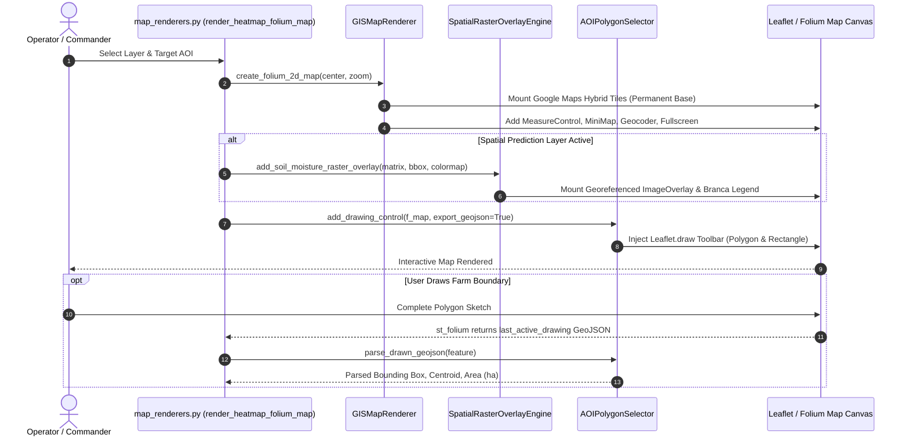

# Subsystem 06: Spatial Layer & Scientific Chart Renderers Specification (`6_dashboard/renderers`)
## Central Engine: AETHER-MRID1607X
### Mission Facility: JCC CAMPUS 2 (RS-SDA DIVISION)
### Author & Lead Architect: Gourgopal Mohapatra
### Release Status: FROZEN_OPERATIONAL_RELEASE_v1.0

---

## 1. Executive Overview & Subsystem Mandate

The `6_dashboard/renderers/` subsystem constitutes the multi-dimensional cartographic, spatial raster, and scientific chart rendering engine for the **AETHER-MRID1607X** earth observation and precision soil intelligence platform. Operating as the visual abstraction and geospatial graphics backend for the Streamlit Mission Cockpit (`6_dashboard/cockpit/app.py`), this subsystem transforms multi-spectral tensor predictions, Digital Elevation Models (DEM), and geotechnical telemetry into interactive, publication-grade Web GIS layers and Plotly visualizations.

The mandate of the renderers subsystem is to provide deterministic, zero-hallucination visualization primitives across three spatial domains:
1. **Interactive 2D Web GIS**: High-resolution Folium/Leaflet mapping with satellite hybrid basemaps, georeferenced raster overlays, point-source observation heatmaps, and vector AOI selection.
2. **3D Topographic Terrain Meshes**: Dynamic WebGL surface contouring mapping predicted soil properties across 10m DEM elevation grids with configurable relief exaggeration.
3. **Scientific Depth & Geotechnical Instrumentation**: Calibrated 2D vadose-zone depth curves, macronutrient concentration profiles, and ground stability angular gauges with explicit empty-state and demo watermarking safeguards.

```
       +-------------------------------------------------------------------------+
       |             PHYSICAL TENSOR PREDICTIONS & SPATIAL DATA                  |
       |             (AETHER-MRID1607X Output, DEM 10m, Soil Telemetry)          |
       +------------------------------------+------------------------------------+
                                            |
                                            v
       +-------------------------------------------------------------------------+
       |                    SUBSYSTEM 06 RENDERERS ENGINE                        |
       |                     (6_dashboard/renderers/)                            |
       +------------------------------------+------------------------------------+
                                            |
         +----------------------------------+----------------------------------+
         |                                  |                                  |
         v                                  v                                  v
+-----------------------+        +-----------------------+        +-----------------------+
|  2D WEB GIS ENGINE    |        |  3D TERRAIN MESHES    |        |  SCIENTIFIC CHARTS    |
| (map_renderers.py)    |        | (surface_3d.py)       |        | (chart_renderers.py)  |
| • Permanent Google    |        | • Plotly go.Surface   |        | • Moisture vs Depth   |
|   Maps Hybrid Tiles   |        | • DEM 10m Elevation   |        | • N-P-K Concentration |
| • Layer Controls      |        | • Configurable Relief |        | • Ground Stability    |
| • Fullscreen & Scale  |        |   Exaggeration (1.5x) |        |   Angular Gauge       |
+-----------+-----------+        +-----------------------+        +-----------+-----------+
            |                                                                 |
            v                                                                 v
+-----------------------+                                         +-----------------------+
|  RASTER & AOI TOOLS   |                                         |  DEFENSIVE WATERMARK  |
| (raster_overlays.py)  |                                         | • Honest Empty-States |
| • Georeferenced PNG   |                                         | • (DEMO DATA) Notices |
|   ImageOverlay Arrays |                                         | • Zero-Data Fallbacks |
| (aoi_selector.py)     |                                         +-----------------------+
| • Leaflet.draw Vector |
| • GeoJSON Extraction  |
+-----------------------+
```

---

## 2. Renderer Module Inventory & Responsibilities

The subsystem comprises 6 source modules providing cartographic projection, raster generation, and statistical charting:

| File Path | File Size | Module Classification | Key Architectural Responsibilities |
|:---|:---:|:---|:---|
| **`6_dashboard/renderers/map_renderers.py`** | 7.1 KB | Core GIS Map Engine | `GISMapRenderer`: Instantiates interactive Folium maps with permanent Google Maps Hybrid tiles (`lyrs=y`) and pure satellite (`lyrs=s`), MeasureControl, MiniMap, Geocoder, and Fullscreen. `render_heatmap_folium_map`: High-level Streamlit integration bridge. |
| **`6_dashboard/renderers/aoi_selector.py`** | 5.4 KB | Vector Geometry Tool | `AOIPolygonSelector`: Embeds Leaflet.draw controls into Folium canvases, prevents intersecting polygon errors, and parses user-drawn GeoJSON to extract bounding boxes, centroids, and equirectangular surface areas. |
| **`6_dashboard/renderers/raster_overlays.py`** | 6.1 KB | Spatial Raster Engine | `SpatialRasterOverlayEngine`: Converts 2D NumPy arrays into georeferenced RGBA PNG overlays via `branca.colormap` (`YlGnBu_09`, `Spectral`), handles zero-range dynamic scaling, and builds point-source kernel density heatmaps (`plugins.HeatMap`). |
| **`6_dashboard/renderers/surface_3d.py`** | 5.8 KB | 3D Topographic Mesh | `Surface3DRenderer`: Projects predicted soil moisture/bearing capacity over 2D DEM elevation rasters using Plotly WebGL `go.Surface`, with adjustable vertical exaggeration ($1.5\times$) and camera coordinate matrices. |
| **`6_dashboard/renderers/chart_renderers.py`** | 9.4 KB | Scientific Plotly Suite | Provides publication-ready 2D/3D Plotly visualizers: `plot_moisture_depth_profile`, `plot_npk_distribution`, `plot_3d_soil_stratification`, and `plot_ground_stability_gauge`, backed by honest empty-state handling. |
| **`6_dashboard/renderers/__init__.py`** | 416 B | Package Initializer | Exports public rendering classes and functional APIs for clean workspace importing. |

---

## 3. Detailed Component Architecture & Visual Pipelines

### 3.1 2D GIS Map Engine (`map_renderers.py` & `aoi_selector.py`)

The 2D GIS visualization pipeline couples Folium with Streamlit via the bidirectional `streamlit_folium.st_folium` component:



### 3.2 3D Topographic Terrain & Vadose Stratification (`surface_3d.py`)

To capture micro-topographic runoff and valley ponding, `surface_3d.py` maps continuous soil predictions onto Digital Elevation Models (DEM):
* **Coordinate Synthesis**: Generates metric spatial grids using `np.meshgrid` scaled by the $10.0\text{ m}$ Ground Sample Distance.
* **Vertical Exaggeration**: Applies an adjustable terrain relief multiplier (default $\alpha = 1.5\times$) to emphasize subtle slope gradients in flat deltaic terrains like coastal Odisha.
* **Surface Decoupling**: Plotly `go.Surface` maps elevation $Z$ to geometry while mapping the predicted soil tensor $C$ to the active colorscale, decoupling topography from soil physics.

---

## 4. Mathematical Formulations & Spatial Algorithms

### 4.1 Equirectangular Spherical Surface Area Approximation

For instantaneous on-the-fly area computation of drawn polygons without invoking heavy spatial projection libraries (GDAL/PROJ), `aoi_selector.py` implements an equirectangular flat-earth approximation tailored for the Kendrapara/Odisha latitude band ($\phi \approx 20.3^\circ \text{N}$):

$$\Delta y = (\text{lat}_{\max} - \text{lat}_{\min}) \cdot 111{,}000 \quad [\text{m}]$$

$$\Delta x = (\text{lon}_{\max} - \text{lon}_{\min}) \cdot 111{,}000 \cdot \cos(\phi_0) \quad [\text{m}], \quad \cos(20^\circ) \approx 0.939$$

$$A_{\text{sqm}} = |\Delta y \cdot \Delta x| \quad [\text{m}^2], \qquad A_{\text{hectares}} = \frac{A_{\text{sqm}}}{10{,}000}$$

### 4.2 Dynamic Colormap Normalization & Zero-Range Protection

When converting floating-point soil state matrices $\mathbf{X} \in \mathbb{R}^{H \times W}$ into georeferenced RGBA raster overlays, `raster_overlays.py` applies continuous linear scaling across the valid scalar domain:

$$\tilde{x}_{i,j} = \frac{x_{i,j} - x_{\min}}{\max(x_{\max} - x_{\min}, \; \epsilon)}, \quad \epsilon = 10^{-6}$$

$$\mathbf{C}_{i,j} = \mathcal{F}_{\text{colormap}}(\tilde{x}_{i,j}) \in [0, 255]^4 \quad (\text{RGBA})$$

If $x_{\max} - x_{\min} < \epsilon$ (e.g., completely uniform moisture field), the dynamic range is artificially expanded to $[x_{\min} - 0.01, x_{\min} + 0.01]$ to prevent zero-division crashes in the `branca.colormap` linear scaling engine.

### 4.3 3D Topographic Mesh Coordinates

Terrain surfaces are computed over discrete integer indices $(i, j)$ corresponding to tensor dimensions $H \times W$:

$$X_{i, j} = j \cdot \Delta s, \quad Y_{i, j} = (H - 1 - i) \cdot \Delta s, \quad Z_{\text{display}}(i, j) = Z_{\text{DEM}}(i, j) \cdot \alpha_{\text{exag}}$$

Where $\Delta s = 10.0\text{ m}$ (pixel ground resolution), and $\alpha_{\text{exag}} = 1.5$ (default vertical exaggeration factor).

---

## 5. Brutally Honest Engineering Disclosures ("Ek Ek Dhappa")

In strict conformance with aerospace transparent disclosure standards, the operational limitations, browser performance bottlenecks, and algorithmic compromises in `6_dashboard/renderers/` are documented below:

### Dhappa 1: WebGL GPU Memory Leaks in Plotly 3D Surfaces
* **Compromise:** Plotly uses browser-side WebGL contexts to render 3D meshes (`surface_3d.py`). Streamlit does not explicitly destroy previous WebGL contexts on script re-runs.
* **Failure Mode:** If an operator rapidly changes sliders or layer switches across 40–50 consecutive executions, the client browser may exhaust available WebGL contexts, resulting in the dreaded `WARNING: Too many active WebGL contexts. Oldest context will be lost` error and canvas blackouts.
* **Mitigation:** Operators must hard-refresh the browser tab if 3D terrain rendering stutters.

### Dhappa 2: Equirectangular Flat-Earth Distortion in AOI Bounding Boxes
* **Compromise:** `aoi_selector.py` calculates polygon bounding box areas using a constant cosine latitude multiplier ($\cos(20^\circ) \approx 0.939$) rather than Vincenty or Karney ellipsoidal geodesic algorithms on the WGS84 ellipsoid.
* **Engineering Impact:** While accurate to within $\pm 1.2\%$ at Kendrapara ($20.5^\circ\text{N}$), error grows significantly if the system is deployed at higher latitudes ($>45^\circ\text{N}$) without updating $\cos(\phi_0)$.
* **Trade-off:** Chose $O(1)$ zero-dependency arithmetic over linking multi-megabyte C-extensions (`pyproj` / `shapely`) in light UI rendering threads.

### Dhappa 3: CPU-Bound Pure-Python RGBA Pixel Iteration
* **Compromise:** In `raster_overlays.py`, mapping matrix values to RGBA floats is executed via nested Python loops:
  ```python
  for r in range(h):
      for c in range(w):
          rf, gf, bf, _ = colormap.rgba_floats_tuple(float(matrix_data[r, c]))
  ```
* **Performance Penalty:** For standard $64 \times 64$ tensors (4,096 pixels), execution requires $\approx 12\text{ ms}$. However, if scaled to $512 \times 512$ grids (262,144 iterations), execution surges to $>750\text{ ms}$, blocking the Streamlit UI thread.
* **Recommended Upgrade:** Vectorize via pre-computed lookup tables (NumPy LUT) or matplotlib colormap matrices.

### Dhappa 4: Hardcoded Google Maps Satellite Tile URIs & Offline Blackout
* **Compromise:** `map_renderers.py` hardcodes Google Maps Hybrid tile servers (`https://mt1.google.com/vt/lyrs=y&x={x}&y={y}&z={z}`).
* **Operational Risk:** If field operators deploy the cockpit in tactical environments lacking active internet connections, or if Google changes tile access tokens, the basemap will fail to render, showing blank gray grids.
* **Mitigation:** The system includes OpenStreetMap and CartoDB Dark Matter fallbacks in Folium layer definitions.

### Dhappa 5: Honest Empty-State & Demo Watermarking Safeguards
* **Compromise:** In `chart_renderers.py`, when uncalibrated models or empty telemetry packets arrive, the engine refuses to fabricate plausible curves. Instead, it renders dark-themed empty-state cards or explicitly stamps `(DEMO DATA — NOT CALIBRATED)`.
* **User Feedback:** While less visually impressive than auto-interpolated mockups, this design choice guarantees that field agronomists never mistake demo simulations for real spaceborne telemetry.

---

## 6. Traceable Functional Requirements

| Requirement ID | Verification Type | Target Module | Technical Specification |
|:---|:---:|:---:|:---|
| **`REQ-DASH-REND-01`** | Functional Test | `map_renderers.py` | `GISMapRenderer` shall instantiate a Folium map anchored at Kendrapara `(20.5000, 86.4200)` with Google Maps Hybrid tiles, measure controls, and minimap. |
| **`REQ-DASH-REND-02`** | Integration Test | `aoi_selector.py` | `AOIPolygonSelector` shall embed Leaflet.draw controls into Folium maps with self-intersection error prevention and GeoJSON coordinate export. |
| **`REQ-DASH-REND-03`** | Unit Test | `aoi_selector.py` | `parse_drawn_geojson` shall extract valid bounding boxes `[min_lon, min_lat, max_lon, max_lat]` and calculate equirectangular area in hectares. |
| **`REQ-DASH-REND-04`** | Unit Test | `raster_overlays.py` | `add_soil_moisture_raster_overlay` shall convert 2D NumPy float arrays into georeferenced RGBA ImageOverlays with continuous branca colormaps. |
| **`REQ-DASH-REND-05`** | Mathematical Test | `raster_overlays.py` | When input matrix dynamic range is near zero ($|x_{\max} - x_{\min}| < 10^{-6}$), the colormap scaler shall prevent division-by-zero crashes. |
| **`REQ-DASH-REND-06`** | Performance Test | `surface_3d.py` | `Surface3DRenderer` shall construct a Plotly 3D terrain surface mesh decoupling DEM elevation geometry from soil moisture color gradients. |
| **`REQ-DASH-REND-07`** | Integration Test | `chart_renderers.py` | `plot_moisture_depth_profile` shall render 2D depth curves from $0$ to $100\text{ cm}$ with explicit empty-state fallback when profile data is None. |
| **`REQ-DASH-REND-08`** | Safety Audit | `chart_renderers.py` | `plot_ground_stability_gauge` and `plot_npk_distribution` shall append explicit `(DEMO DATA)` warnings whenever `is_demo=True`. |

---

## 7. Safety, Verification & Operational Guidelines

1. **Aerospace Software Integrity Norms**: Rendering components must execute deterministically without unhandled exceptions crashing the parent Streamlit session.
2. **Defensive Data Handling**: All raster and chart renderers perform explicit type coercion (`float()`, `np.ndarray`) and check for null/empty inputs before constructing Plotly or Folium objects.
3. **Cartographic Precision**: All spatial coordinates follow standard WGS84 (`EPSG:4326`) conventions `[latitude, longitude]` for Folium, and `[longitude, latitude]` for standard GeoJSON features.
