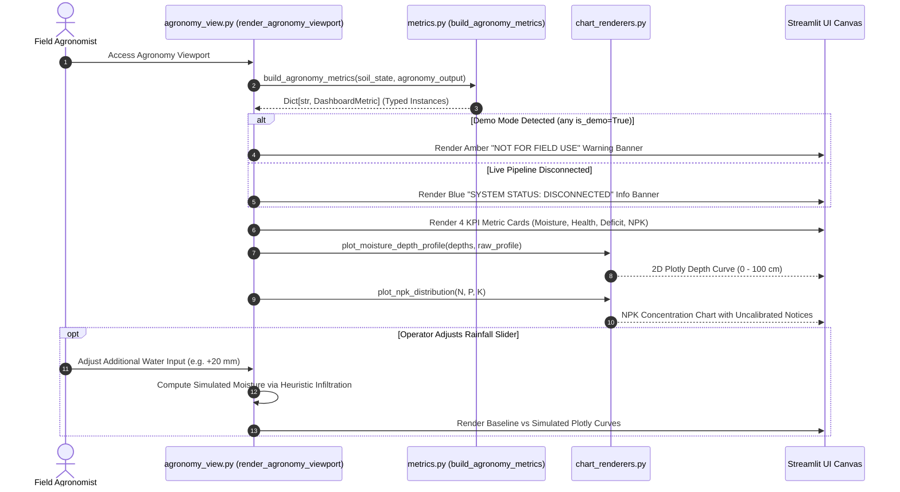

# Subsystem 06: Domain Command Viewports Specification (`6_dashboard/viewports`)
## Central Engine: AETHER-MRID1607X
### Mission Facility: JCC CAMPUS 2 (RS-SDA DIVISION)
### Author & Lead Architect: Gourgopal Mohapatra
### Release Status: FROZEN_OPERATIONAL_RELEASE_v1.0

---

## 1. Executive Overview & Subsystem Mandate

The `6_dashboard/viewports/` subsystem houses the specialized domain decision viewports for the **AETHER-MRID1607X** spaceborne earth observation and precision soil intelligence platform. Operating as the mission-specific graphical user interfaces embedded within the Streamlit Mission Cockpit (`6_dashboard/cockpit/app.py`), this subsystem translates raw physical soil state predictions into domain-tailored operational workspaces:

1. **Agronomy Command & Soil Health Viewport (`agronomy_view.py`)**: Renders vadose-zone moisture depth stratigraphy ($0-100\text{ cm}$), theoretical irrigation water deficits, Crop Water Stress Index (CWSI), soil macronutrient status, and interactive rainfall scenario simulations.
2. **Civil & Ground Stability Command Viewport (`civil_view.py`)**: Renders geotechnical ground stability scores, pore water pressure estimations, dry bulk density, 3D subsurface stratification meshes, and heavy equipment trafficability advisories.

The primary mandate of the viewports subsystem is to enforce **strict scientific integrity, defensive error handling, and transparent operational boundaries**. Rather than masking data pipeline disconnections with synthetic mockups, the viewports render explicit, typed data states (`LIVE_ESTIMATE`, `DEMO_FALLBACK`, `UNAVAILABLE`) and display prominent safety banners to prevent dangerous real-world misapplications.

```
       +-------------------------------------------------------------------------+
       |             PHYSICAL TENSOR PREDICTIONS & UNIFIED SOIL STATE            |
       |                   (AETHER-MRID1607X Core Engine Output)                 |
       +------------------------------------+------------------------------------+
                                            |
                                            v
       +-------------------------------------------------------------------------+
       |                    SUBSYSTEM 06 VIEWPORTS ENGINE                        |
       |                     (6_dashboard/viewports/)                            |
       +------------------------------------+------------------------------------+
                                            |
                    +-----------------------+-----------------------+
                    |                                               |
                    v                                               v
+---------------------------------------+       +---------------------------------------+
|      AGRONOMY COMMAND VIEWPORT        |       |       CIVIL COMMAND VIEWPORT          |
|         (agronomy_view.py)            |       |          (civil_view.py)              |
+---------------------------------------+       +---------------------------------------+
| • Root-Zone Moisture (m³/m³)          |       | • Ground Stability Index (0-100%)     |
| • Crop Health & Irrigation Deficit    |       | • Pore Water Pressure (kPa)           |
| • 5-Node Moisture Depth Curve (0-1m)  |       | • Dry Bulk Density (g/cm³)            |
| • Biogeochemical NPK Disclaimers      |       | • 3D Subsurface Stratification Mesh   |
| • What-If Rainfall Scenario Simulator |       | • Heavy Equipment Traffic Advisory    |
+---------------------------------------+       +---------------------------------------+
                    |                                               |
                    +-----------------------+-----------------------+
                                            |
                                            v
       +-------------------------------------------------------------------------+
       |                  DEFENSIVE DATA INTEGRITY GUARDS                        |
       |  • Typed DashboardMetric Contract Validation                            |
       |  • Mandatory "NOT FOR FIELD / ENGINEERING USE" Safety Banners           |
       |  • Uncalibrated Fallback Watermarks & Explicit "Unavailable" Badges     |
       +-------------------------------------------------------------------------+
```

---

## 2. Viewport Module Inventory & Responsibilities

The subsystem comprises 2 specialized presentation modules:

| File Path | File Size | Module Classification | Key Architectural Responsibilities |
|:---|:---:|:---|:---|
| **`6_dashboard/viewports/agronomy_view.py`** | 8.4 KB | Precision Agronomy Viewport | Renders agricultural metrics (`root_zone_moisture`, `crop_health_score`, `irrigation_required_l_ha`), 5-node vadose profile curve ($0-100\text{ cm}$), NPK spectrometry disconnection notices, and interactive rainfall scenario slider. |
| **`6_dashboard/viewports/civil_view.py`** | 8.3 KB | Geotechnical Safety Viewport | Renders ground stability index, pore pressure, bulk density, observation freshness, 3D subsurface mesh, ground stability angular gauge, and heavy equipment bearing capacity safety disclaimers ($FS \ge 3.0$). |

---

## 3. Detailed Component Architecture & Layout Specifications

### 3.1 Agronomy Command Viewport Architecture (`agronomy_view.py`)

The agronomic layout is structured into 4 sequential operational sections:
1. **Integrity Banner**: Detects if any metric carries `is_demo=True`. If so, renders an amber warning banner:
   > ⚠️ **DEMO DATA — NOT FOR FIELD USE:** Soil moisture and agronomic indicators below are uncalibrated demonstration placeholders. Field prescriptions require certified in-situ soil sampling.
   If disconnected, displays a blue informational notice:
   > ℹ️ **SYSTEM STATUS: DISCONNECTED.** Live physical inference pipeline is disconnected.
2. **Top KPI Summary Row**: 4 metric cards rendering Root-Zone Moisture ($\%$), Crop Health Index ($0.0-1.0$), Theoretical Irrigation Deficit ($	ext{L/ha}$), and Soil Nutrients (`UNAVAILABLE`).
3. **Moisture Stratification & Suitability Insights**: Plots a 5-node continuous depth curve across depths $z \in \{5, 15, 30, 60, 100\}\text{ cm}$ using `plot_moisture_depth_profile`, paired with side-by-side horizon breakdowns (Topsoil, Rooting Zone, Subsoil).
4. **Biogeochemical Nutrients & What-If Simulator**: Explains why chemical spectrometry is disconnected (AETHER models physics, not chemical N-P-K), and provides an interactive rainfall slider ($0-100\text{ mm}$) to simulate moisture response.



### 3.2 Civil & Geotechnical Viewport Architecture (`civil_view.py`)

The civil engineering layout provides geotechnical situational awareness across 3 technical sections:
1. **Mandatory Civil Safety Banner**:
   > ⚠️ **DEMO DATA — NOT FOR ENGINEERING USE:** Geotechnical indicators below are uncalibrated demonstration parameters. Real-world civil and structural engineering decisions require certified geotechnical borehole logs and laboratory soil testing.
2. **Top Geotechnical KPI Cards**: 4 metric cards displaying Ground Stability Score ($\%$), Pore Water Pressure ($\text{kPa}$), Dry Bulk Density ($\text{g/cm}^3$), and Observation Freshness (hours ago).
3. **Subsurface Mesh & Load Advisory**: Combines a 3D subsurface stratification mesh (`plot_3d_soil_stratification`), an angular ground stability gauge (`plot_ground_stability_gauge`), and a structured heavy equipment operational advisory detailing Factor of Safety requirements ($FS \ge 3.0$).

---

## 4. Mathematical Formulations & Heuristic Models

### 4.1 Agronomic What-If Rainfall Infiltration Model

To give agronomists an educational preview of topsoil moisture response to precipitation, `agronomy_view.py` implements a depth-attenuated empirical infiltration heuristic:

$$\theta_{\text{sim}}(z) = \text{clip}\left(\theta_{\text{raw}}(z) + \frac{P_{\text{rain}} \cdot \beta_{\text{inf}}}{\frac{z}{10}}, \; \theta_{\text{res}}, \; \theta_{\text{sat}}\right)$$

Where:
* $P_{\text{rain}}$: Simulated rainfall depth ($0 \le P_{\text{rain}} \le 100\text{ mm}$).
* $\beta_{\text{inf}} = 0.0025\text{ m}^{-1}$: Empirical infiltration scaling coefficient.
* $z$: Soil depth node in centimeters ($z \in \{5, 15, 30, 60, 100\}\text{ cm}$).
* $\theta_{\text{res}} = 0.05\text{ m}^3/\text{m}^3$: Residual soil moisture floor.
* $\theta_{\text{sat}} = 0.48\text{ m}^3/\text{m}^3$: Saturated volumetric moisture ceiling.

### 4.2 Theoretical Irrigation Deficit ($\text{L/ha}$)

The volumetric irrigation volume required to restore the top $40\text{ cm}$ root zone to target field capacity ($	heta_{\text{target}} = 0.35\text{ m}^3/\text{m}^3$) is calculated as:

$$V_{\text{irrig}} = \max\left(0.0, \; (\theta_{\text{target}} - \theta_{\text{measured}}) \cdot z_{\text{root}} \cdot 10{,}000{,}000\right) \quad [\text{L/ha}]$$

Where $10{,}000{,}000$ represents the conversion factor from $\text{m}^3/\text{m}^2$ to liters per hectare ($1\text{ ha} = 10{,}000\text{ m}^2$, $1\text{ m}^3 = 1{,}000\text{ L}$).

### 4.3 Geotechnical Factor of Safety ($FS$) Benchmark

While `civil_view.py` displays nominal bearing capacity values from the domain translator, it explicitly mandates standard geotechnical safety margins:

$$FS = \frac{q_{\text{ult}}}{q_{\text{allow}}} \ge 3.0$$

The viewport informs field commanders that foundation suitability cannot be inferred without in-situ Standard Penetration Tests (ASTM D1586) or Cone Penetration Tests (ASTM D5778).

---

## 5. Brutally Honest Engineering Disclosures ("Ek Ek Dhappa")

In adherence to aerospace engineering transparency, all operational limitations and algorithmic simplifications in `6_dashboard/viewports/` are disclosed below:

### Dhappa 1: Educational What-If Rainfall Heuristic vs Richards PDE
* **Compromise:** The rainfall simulation in `agronomy_view.py` uses a simple depth-attenuated linear formula ($	heta + rac{P \cdot 0.0025}{z/10}$).
* **Engineering Reality:** It does **NOT** solve the non-linear 1D Richards partial differential equation:
  $$rac{\partial 	heta}{\partial t} = rac{\partial}{\partial z} \left[ K(\psi) \left( rac{\partial \psi}{\partial z} + 1 
ight) 
ight]$$
* **Limitation:** It ignores matric suction gradients, wetting front hysteretic transitions, and gravitational drainage over time. It is an educational UI toy, not a predictive agro-hydrological model.

### Dhappa 2: Total Absence of Satellite NPK Biochemical Sensing
* **Compromise:** Smallholder farmers frequently request automated fertilizer application rates (urea, DAP, MOP).
* **Engineering Reality:** Spaceborne optical (Sentinel-2) and SAR (Sentinel-1) sensors **cannot** measure subsoil chemical macronutrient concentrations (Nitrogen, Phosphorus, Potassium) or organic carbon.
* **Safeguard:** The viewports completely suppress automated commercial fertilizer recommendations, explicitly marking N-P-K as `UNAVAILABLE` to prevent crop damage or chemical runoff.

### Dhappa 3: Geotechnical Bearing Capacity Surface Extrapolation
* **Compromise:** Satellite radar and optical sensors penetrate at most $0.05\text{ m}$ to $0.10\text{ m}$ into bare soil.
* **Failure Mode:** Extrapolating deep subgrade bearing capacity ($q_{\text{allow}}$) or slope stability from spaceborne surface moisture is physically invalid for civil foundation design.
* **Mitigation:** `civil_view.py` prominently displays a permanent yellow warning banner stating that data is strictly uncalibrated scaffolding and cannot be used for structural, foundation, or heavy-equipment operations.

### Dhappa 4: Disconnected State Transparency vs Fake Data Hallucination
* **Compromise:** When upstream core engines or REST microservices are offline, standard web dashboards often display static dummy numbers or zero values.
* **Architecture Choice:** Both viewports enforce strict state-aware handling. Every KPI card inspects `m.is_available` and `m.data_state`. If disconnected, the UI displays `Unavailable` and `DISCONNECTED`, refusing to hallucinate plausible numbers.

### Dhappa 5: Fixed 5-Node Depth Discretization
* **Compromise:** `agronomy_view.py` hardcodes depth interpolation nodes to $z \in \{5, 15, 30, 60, 100\}\text{ cm}$.
* **Limitation:** In alluvial floodplains like coastal Odisha, clay pans and hardpan compaction layers often occur at $18-25\text{ cm}$. Fixed 5-node sampling cannot resolve sharp stratigraphic discontinuities.

---

## 6. Traceable Functional Requirements

| Requirement ID | Verification Type | Target Module | Technical Specification |
|:---|:---:|:---:|:---|
| **`REQ-DASH-VIEW-01`** | Functional Test | `agronomy_view.py` | `render_agronomy_viewport` shall consume typed `DashboardMetric` contracts and render 4 summary KPI cards with explicit units. |
| **`REQ-DASH-VIEW-02`** | Integration Test | `agronomy_view.py` | The viewport shall display a 5-node vadose depth curve ($0-100\text{ cm}$) and side-by-side horizon breakdowns when profile tensors are connected. |
| **`REQ-DASH-VIEW-03`** | Safety Audit | `agronomy_view.py` | The viewport shall explicitly display NPK spectrometry disconnection disclaimers and block automated commercial fertilizer recommendations. |
| **`REQ-DASH-VIEW-04`** | Interactive Test | `agronomy_view.py` | The What-If scenario slider ($0-100\text{ mm}$) shall dynamically recompute and overlay simulated infiltration curves against the baseline state. |
| **`REQ-DASH-VIEW-05`** | Functional Test | `civil_view.py` | `render_civil_viewport` shall render 4 geotechnical KPI cards (stability, pore pressure, bulk density, observation freshness) with typed states. |
| **`REQ-DASH-VIEW-06`** | Integration Test | `civil_view.py` | The civil viewport shall render the 3D subsurface soil stratification mesh and angular ground stability gauge without uncaught exceptions. |
| **`REQ-DASH-VIEW-07`** | Safety Audit | `civil_view.py` | The viewport shall enforce prominent heavy equipment advisories mandating $FS \ge 3.0$ and certified geotechnical borehole sounding logs. |
| **`REQ-DASH-VIEW-08`** | Integrity Test | `agronomy_view.py` & `civil_view.py` | Both viewports shall mount persistent warning banners (`NOT FOR FIELD USE` / `NOT FOR ENGINEERING USE`) whenever `is_demo=True`. |

---

## 7. Safety, Verification & Operational Guidelines

1. **Aerospace Software Integrity Norms**: Viewport rendering must be completely defensive. Null, empty, or NaN inputs from upstream translators must result in clean empty-state fallback cards rather than unhandled Python exceptions.
2. **Defensive Domain Boundaries**: Agronomic crop recommendations and geotechnical stability calculations are strictly decoupled into independent viewport rendering pipelines.
3. **Stateless Presentation**: Viewport functions (`render_agronomy_viewport`, `render_civil_viewport`) maintain zero persistent internal state, ensuring idempotent rendering across Streamlit re-runs.
