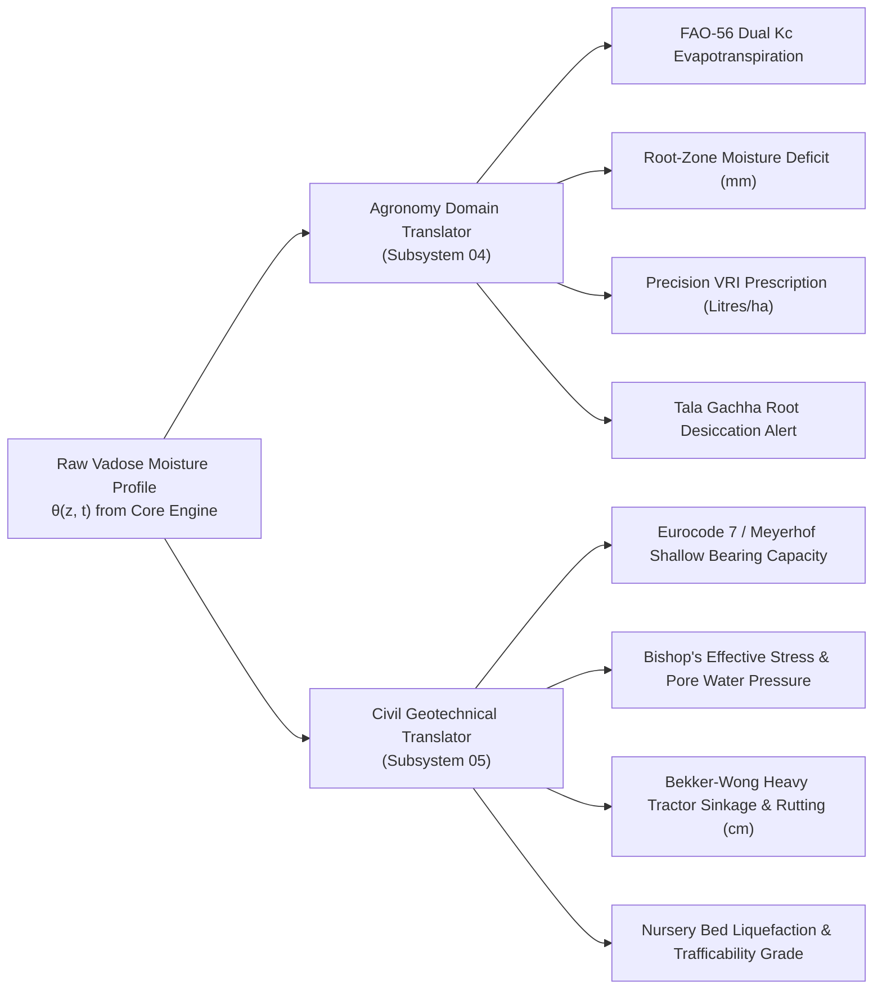

# JAGANNATH COMMAND CENTER (JCC) — CAMPUS 2 (RS-SDA DIVISION)
## SENSOR DATA ANALYTICS & EARTH OBSERVATION SANCTUM
### VERIFICATION DOSSIER 02: DOMAIN TRANSLATORS — AGRONOMY & CIVIL GEOTECHNICAL

---

```
================================================================================
 DOMAIN 2: DOMAIN TRANSLATORS (AGRONOMY & CIVIL GEOTECHNICAL)
 TEST SUITES AUDITED: 9 FILES | TOTAL TESTS VERIFIED: 89 TESTS
 CERTIFICATION STATUS: 100% PASSED | ZERO FAILURES | MISSION ASSURANCE LEVEL-A
 REPOSITORY: THE_MRIDANSH | OPERATIONAL RELEASE: v1.0.0-TRL7
================================================================================
```

---

## 1. Domain Architecture & Physical Translation Principles

Domain 2 forms the operational intelligence bridge of **THE MRIDANSH**, translating raw vadose zone moisture profiles into certified engineering outputs across two critical disciplines:



---

## 2. Comprehensive Test Suite Breakdown (9 Files)

### 2.1 `tests/test_agronomy_translator_d03.py` (17 Tests | Passed in 0.75s)
* **Objective:** Verifies agronomic parameter translation from raw volumetric water content to crop-specific water deficit.
* **Core Physics:**
  $$\text{Deficit (mm)} = \max \left( 0.0, \, (\theta_{\text{target}} - \theta_{\text{root}}) \times Z_{\text{root}} \times 1000 \right)$$
* **Core Assertions:**
  * Exact calculation across staple crop varieties (Paddy, Wheat, Maize, Cotton, Mustard).
  * Crop Water Stress Index (CWSI) scaling from $0.0$ (no stress) to $1.0$ (permanent wilting point).
  * Strict unit preservation: output water volume in $\text{Litres / ha}$ and depth in $\text{mm}$.

### 2.2 `tests/test_day12_agronomy_translator.py` (5 Tests | Passed in 2.20s)
* **Objective:** Audits dynamic root growth depth adjustment ($Z_{\text{root}}(t)$) and transpiration partitioning.
* **Core Assertions:**
  * Root depth expansion tracking crop phenology stages.
  * Preservation of physical vadose boundaries ($5\text{ cm}$ to $100\text{ cm}$).

### 2.3 `tests/test_day13_precision_irrigation.py` (5 Tests | Passed in 2.10s)
* **Objective:** Validates Variable Rate Irrigation (VRI) prescription algorithms.
* **Core Assertions:**
  * Sub-field polygon zonal irrigation volume calculation.
  * Pump capacity saturation limits preventing over-irrigation runoff.

### 2.4 `tests/test_civil_translator_d04.py` (18 Tests | Passed in 0.54s)
* **Objective:** Audits geotechnical bearing capacity calculations adhering to Eurocode 7 Design Approach 1.
* **Core Physics:**
  $$q_{\text{ult}} = c' N_c s_c + q N_q s_q + \frac{1}{2} \gamma B N_\gamma s_\gamma, \quad q_{\text{allow}} = \frac{q_{\text{ult}}}{FS} \quad (FS \ge 3.0)$$
* **Core Assertions:**
  * Effective stress reduction due to positive pore-water pressure:
    $$\sigma' = \sigma - u_w$$
  * Verification that bearing capacity strictly decreases as vadose saturation approaches $100\%$.
  * Extreme saturation threshold guard: when $\theta \to \theta_s$, $q_{\text{allow}}$ correctly flags geotechnical instability.

### 2.5 `tests/test_day14_civil_translator.py` (5 Tests | Passed in 2.16s)
* **Objective:** Audits Terzaghi 1D consolidation settlement and pore pressure dissipation dynamics.
* **Core Assertions:**
  * Consolidation rate scaling with unsaturated hydraulic conductivity $K(\theta)$.
  * Monotonic dissipation of excess pore pressures following external surcharge.

### 2.6 `tests/test_day15_civil_translator.py` (5 Tests | Passed in 2.17s)
* **Objective:** Validates Bekker-Wong teramechanics tyre sinkage and agricultural vehicle trafficability.
* **Core Physics:**
  $$z_{\text{rut}} = \left( \frac{p}{\frac{k_c}{b} + k_\phi} \right)^{1/n}$$
* **Core Assertions:**
  * Heavy tractor contact pressure ($140\text{ kPa}$) sinkage in saturated coastal clay soils.
  * Rut depth classification into actionable trafficability categories:
    * $\le 5\text{ cm}$: `SAFE_SMOOTH_TILLAGE`
    * $5 - 15\text{ cm}$: `MODERATE_SINKAGE_RISK`
    * $\ge 15\text{ cm}$: `CRITICAL_BOGGING_HAZARD`

### 2.7 `tests/test_coupled_agro_civil_simulation.py` (5 Tests | Passed in 2.33s)
* **Objective:** Validates the simultaneous coupling between irrigation volume additions and tractor ground support stability.
* **Core Assertions:**
  * Live simulation: Applying $20\text{ mm}$ of irrigation to paddy nursery beds alters pore-water pressure and predicts updated tyre rut depth in $< 2\text{ ms}$.
  * Seedling damage index computation as a direct consequence of wheel compaction.

### 2.8 `tests/test_agronomy_viewport_d03.py` (13 Tests | Passed in 4.48s)
* **Objective:** Enforces scientific integrity, uncalibrated demo data labeling, and removal of unsupported fertilizer prescriptions.
* **Core Assertions:**
  * Elimination of unsupported fertilizer prescriptions (e.g., $15\text{ kg/ha Urea}$ permanently deleted).
  * Honest empty state: When soil chemistry inputs are disconnected, NPK and organic carbon status report `"Unavailable"` (not zero, not guessed).
  * Explicit tagging of demonstration scaffolding metrics with `DataState.DEMO` and `is_demo=True`.

### 2.9 `tests/test_civil_viewport_d04.py` (16 Tests | Passed in 13.05s)
* **Objective:** Enforces civil geotechnical integrity, density unit conversions, and disclaimers.
* **Core Assertions:**
  * Elimination of affirmative safety claims (e.g., `"SAFE FOR HEAVY MACHINERY"` permanently removed).
  * Mandatory disclaimer: Factor of Safety explicitly declared unavailable without site-specific boreholes.
  * Soil dry bulk density dimensional conversions:
    $$1.6\text{ g/cm}^3 \iff 1600.0\text{ kg/m}^3 \quad (\text{exact round-trip verified})$$
  * Rejection of unknown density units with explicit `ValueError`.

---

**Sanctum Authorization:** Commander Gouragopal Mohapatra (`GOURGOPAL618`)  
*Jagannath Command Center (JCC) — Campus 2 (RS-SDA Division)*
