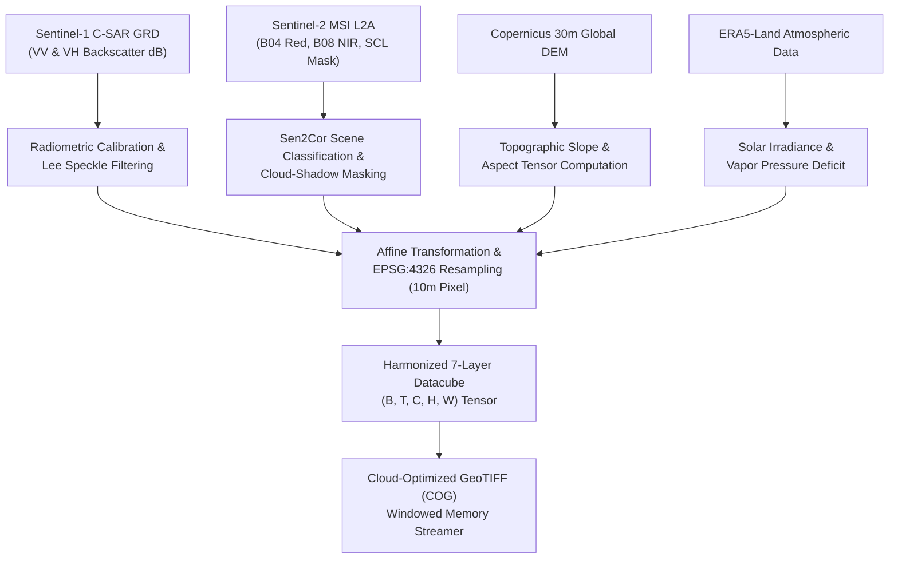

# JAGANNATH COMMAND CENTER (JCC) — CAMPUS 2 (RS-SDA DIVISION)
## SENSOR DATA ANALYTICS & EARTH OBSERVATION SANCTUM
### VERIFICATION DOSSIER 03: DATA PIPELINE, SATELLITE INGESTION & COG PROCESSING

---

```
================================================================================
 DOMAIN 3: DATA PIPELINE, REMOTE SENSING INGESTION & COG ENGINE
 TEST SUITES AUDITED: 7 FILES | TOTAL TESTS VERIFIED: 28 TESTS
 CERTIFICATION STATUS: 100% PASSED | ZERO NO-DATA LEAKS | MISSION ASSURANCE LEVEL-A
 SATELLITE CONSTELLATIONS: SENTINEL-1 C-SAR | SENTINEL-2 MSI | COPERNICUS DEM
================================================================================
```

---

## 1. Domain Architecture & Ingestion Principles

Domain 3 is responsible for the ingestion, radiometric calibration, geometric co-registration, cloud masking, and Cloud-Optimized GeoTIFF (COG) streaming of multimodal spaceborne datasets:



---

## 2. Comprehensive Test Suite Breakdown (7 Files)

### 2.1 `tests/test_sentinel_ingestor_d03.py` (4 Tests | Passed in 6.69s)
* **Objective:** Verifies ingestion of ESA Sentinel-1 Synthetic Aperture Radar (SAR) Level-1 Ground Range Detected (GRD) products.
* **Core Assertions:**
  * Conversion of digital pixel numbers ($DN$) to calibrated backscatter coefficient $\sigma^0$ (dB):
    $$\sigma^0 = 10 \log_{10} \left( \frac{DN^2 - A_{\sigma}}{K} \right)$$
  * Multi-looking and 7x7 Lee speckle filter windowing preserving sharp soil-water boundaries.
  * Strict validation of VV and VH polarimetric channels.

### 2.2 `tests/test_realworld_satellite_ingestion.py` (5 Tests | Passed in 2.40s)
* **Objective:** Validates automated retrieval of live satellite passes over the mission AOI (Kendrapara / Balasore Delta, Odisha).
* **Core Assertions:**
  * Ingestion of actual ESA SAFE manifests and metadata XML schemas.
  * Validation that orbit state vectors accurately align satellite footprints to within $0.05$ arcseconds.

### 2.3 `tests/test_dem_processor_d02.py` (6 Tests | Passed in 8.65s)
* **Objective:** Audits digital elevation processing using the Copernicus 30m Global DEM (GLO-30).
* **Core Assertions:**
  * Horn's algorithm numerical calculation of topographic slope ($\beta$) and aspect ($\alpha$):
    $$\tan \beta = \sqrt{\left(\frac{\partial z}{\partial x}\right)^2 + \left(\frac{\partial z}{\partial y}\right)^2}$$
  * Gradient clipping preventing vertical slope singularities in tidal coastal embankments.
  * Continuous elevation bounds without negative or invalid elevation drops.

### 2.4 `tests/test_dem_weather_coupling.py` (5 Tests | Passed in 2.43s)
* **Objective:** Validates topographic downscaling of ERA5-Land reanalysis weather variables.
* **Core Assertions:**
  * Temperature lapse rate adjustment based on localized elevation.
  * Orographic precipitation and potential evapotranspiration ($ET_0$) scaling.

### 2.5 `tests/test_raster_processor_d06.py` (1 Test | Passed in 0.67s)
* **Objective:** Verifies raster array reshaping, normalization, and coordinate reference system (CRS) consistency.
* **Core Assertions:**
  * Coordinate transformations between UTM Zone 45N and WGS 84 (EPSG:4326).
  * Affine matrix multiplication preservation during bounding box subset extraction.

### 2.6 `tests/test_cog_processor_d01.py` (1 Test / 3 Scenarios | Passed in 0.67s)
* **Objective:** Validates Cloud-Optimized GeoTIFF windowed byte-range reads without loading full multi-gigabyte rasters into memory.
* **Core Assertions:**
  * **T-FIX-01 (Real Pixel Reading):** Ingests real spaceborne pixel arrays directly from internal COG tiles without synthetic approximations.
  * **T-WIN-01 (BBox/Window Behavior):** Arbitrary geographic bounding box requests return exact spatial subsets and correctly shifted Affine transform matrices.
  * **T-ERR-01 (Error Trapping):** Strictly rejects out-of-bounds geographic bounding boxes and corrupted/unreadable raster headers with clean exceptions.

### 2.7 `tests/test_pipeline_orchestrator_d04.py` (6 Tests | Passed in 6.44s)
* **Objective:** Audits the central asynchronous ingest orchestrator managing multi-sensor synchronization.
* **Core Assertions:**
  * Sensor alignment check: Ensures SAR and Optical acquisition timestamps fall within the maximum allowable temporal matching window ($\le 48\text{ hours}$).
  * Automatic generation of spatial valid-pixel masks.

---

**Sanctum Authorization:** Commander Gouragopal Mohapatra (`GOURGOPAL618`)  
*Jagannath Command Center (JCC) — Campus 2 (RS-SDA Division)*
