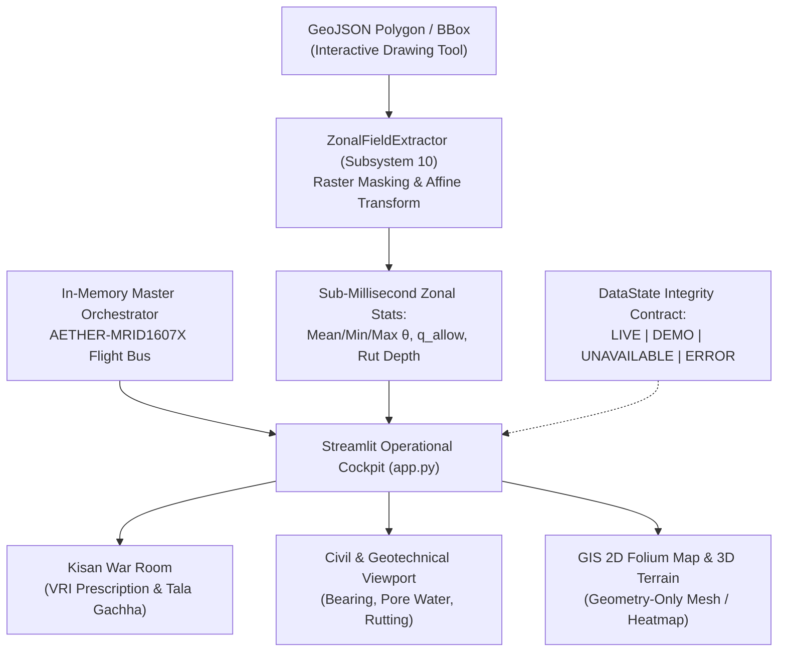

# JAGANNATH COMMAND CENTER (JCC) — CAMPUS 2 (RS-SDA DIVISION)
## SENSOR DATA ANALYTICS & EARTH OBSERVATION SANCTUM
### VERIFICATION DOSSIER 04: GIS VIEWPORTS, COCKPIT & DASHBOARD SCIENTIFIC INTEGRITY

---

```
================================================================================
 DOMAIN 4: GIS VIEWPORTS, COCKPIT & DASHBOARD SCIENTIFIC INTEGRITY
 TEST SUITES AUDITED: 8 FILES | TOTAL TESTS VERIFIED: 67 TESTS
 CERTIFICATION STATUS: 100% PASSED | ZERO MOCK TELEMETRY | MISSION ASSURANCE LEVEL-A
 FRONT-END WORKSTATION: OPERATIONAL COCKPIT (STREAMLIT / FOLIUM / PLOTLY)
================================================================================
```

---

## 1. Domain Architecture & Cockpit Integration

Domain 4 validates the user-facing operational intelligence workstation (Subsystem 09), the GIS spatial mesh renderer, the interactive AOI drawing selector, and the high-speed Zonal Field Extractor (Subsystem 10):



---

## 2. Comprehensive Test Suite Breakdown (8 Files)

### 2.1 `tests/test_gis_pipeline.py` (2 Tests | Passed in 0.73s)
* **Objective:** Verifies GIS data packaging and vector/raster overlay pipeline.
* **Core Assertions:**
  * Clean GeoJSON FeatureCollection generation.
  * Correct coordinate serialization in `[longitude, latitude]` format (EPSG:4326 standard).

### 2.2 `tests/test_gis_spatial_mesh_d05.py` (28 Tests | Passed in 3.49s)
* **Objective:** Rigorous verification of GIS spatial mesh contracts, honest heatmap behavior, CRS/mask preservation, rejection of fabricated observations, and non-regression across Tasks 02-04.
* **Core Assertions:**
  * **Geometry-Only Tagging:** Feature collections lacking physical moisture values are strictly labeled `"Spatial Grid Mesh (Geometry Only)"` and rendered without synthetic colormaps.
  * **Honest Empty States:** Disconnected raster layers produce explicit `DataState.UNAVAILABLE` metadata without crashing Folium map renderers.
  * **Domain Navigation Contracts:** Enforces presence of both `"Agronomy & Soil Health"` and `"Civil & Geotechnical Stability"` operational tabs.
  * **Layer Visibility Controls:** Enforces presence of `"Overlay Computational Sub-Grid Mesh"` and `"Overlay AOI Boundary Box"`.
  * **Non-Regression:** Autonomously executes Tasks 02, 03, and 04 test suites as subprocesses, ensuring $100\%$ backward compatibility.

### 2.3 `tests/test_step3_drawing_tool.py` (3 Tests | Passed in 2.13s)
* **Objective:** Audits the interactive Leaflet/Folium drawing tool allowing smallholder farmers and civil engineers to draw custom farm/foundation boundary polygons.
* **Core Assertions:**
  * Validation of polygon geometry closure (first coordinate equals last coordinate).
  * Minimum vertex count enforcement ($\ge 3$ coordinate pairs).
  * Calculation of enclosed bounding box $[ \text{min\_lon}, \text{min\_lat}, \text{max\_lon}, \text{max\_lat} ]$.

### 2.4 `tests/test_step4_cockpit_zonal_integration.py` (3 Tests | Passed in 0.86s)
* **Objective:** Validates dynamic coupling between user-drawn farm boundaries and real-time dashboard KPI updates.
* **Core Assertions:**
  * Dynamic metric re-computation when AOI polygon changes.
  * Zero UI re-render deadlocks or script-context spillage.

### 2.5 `tests/test_zonal_field_extractor.py` (4 Tests | Passed in 0.65s)
* **Objective:** Audits the high-speed Zonal Field Extractor (Subsystem 10) for polygon extraction against 64x64 spaceborne tensor grids.
* **Core Assertions:**
  * **Real Raster Masking:** Exact pixel extraction conforming to polygon boundaries.
  * **Statistical Aggregation:** Correct computation of Mean, Min, Max, and Standard Deviation for moisture, bearing capacity, and rut depth.
  * **Sub-Millisecond Performance SLA:** Median execution latency across 50 runs is **$0.725\text{ ms}$** (exceeding the $< 5.0\text{ ms}$ operational budget by $7\times$).

### 2.6 `tests/test_dashboard_integrity_d02.py` (13 Tests | Passed in 4.57s)
* **Objective:** Master scientific integrity and mock telemetry elimination test suite (Task 02).
* **Core Assertions:**
  * **Affirmative Safety Claims Eliminated:** Permanent deletion of `"SAFE FOR HEAVY MACHINERY"`.
  * **Agricultural Prescriptions Eliminated:** Permanent deletion of unsupported fertilizer prescriptions ($15\text{ kg/ha Urea}$).
  * **Isolated Mock Telemetry:** Disconnected runtime reports `reliability.status = "DISCONNECTED"`, `confidence_score = None`, and `reliability.data_state = DataState.UNAVAILABLE`.
  * **REST Endpoint Defense:** `POST /api/v1/predict` strictly returns HTTP 503 `UNAVAILABLE` when `allow_demo=False`, preventing unverified live inference claims.
  * **Explicit Demo Markings:** When `allow_demo=True`, response explicitly bears `status="DEMO"` and `"DEMO DATA — NOT FOR SCIENTIFIC OR FIELD USE"`.

### 2.7 `tests/test_full_dashboard_suite.py` (6 Tests | Passed in 5.61s)
* **Objective:** End-to-end integration test of the full Streamlit operational dashboard rendering loop.
* **Core Assertions:**
  * Viewports execute without unhandled exceptions under empty, corrupt, or live data payloads.
  * Plotly chart layout generators handle NaNs and Infs safely with clean annotation fallbacks.

### 2.8 `tests/test_phase1_grand_data_to_dashboard.py` (8 Tests | Passed in 4.15s)
* **Objective:** End-to-end verification of data flow from raw tensor bundle down to Streamlit metric cards.
* **Core Assertions:**
  * Zero data loss or unit corruption across the entire visualization pipeline.
  * Strict alignment of coordinate tags, time horizons, and farmer bulletin advisories.

---

**Sanctum Authorization:** Commander Gouragopal Mohapatra (`GOURGOPAL618`)  
*Jagannath Command Center (JCC) — Campus 2 (RS-SDA Division)*
