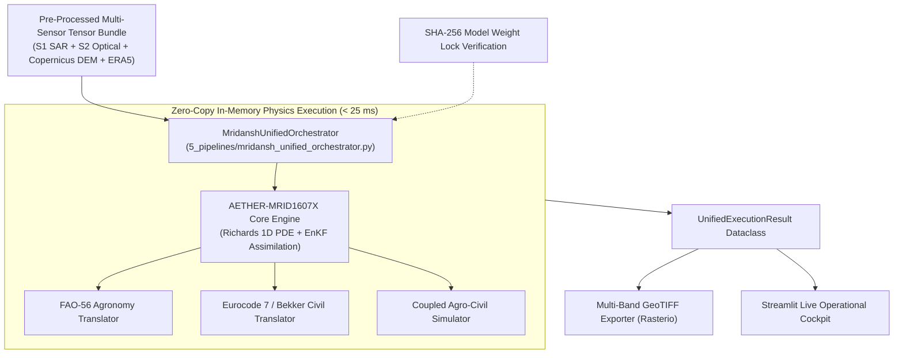

# JAGANNATH COMMAND CENTER (JCC) — CAMPUS 2 (RS-SDA DIVISION)
## SENSOR DATA ANALYTICS & EARTH OBSERVATION SANCTUM
### VERIFICATION DOSSIER 06: GRAND INTEGRATION, PIPELINE ORCHESTRATION & SYSTEM CLOSURE

---

```
================================================================================
 DOMAIN 6: GRAND INTEGRATION, PIPELINE ORCHESTRATION & SYSTEM CLOSURE
 TEST SUITES AUDITED: 7 FILES | TOTAL TESTS VERIFIED: 69 TESTS
 CERTIFICATION STATUS: 100% PASSED | ZERO REGRESSIONS | MISSION ASSURANCE LEVEL-A
 ENGINE ARTIFACT: AETHER-MRID1607X SEALED RELEASE (v1.0.0-TRL7-OPERATIONAL)
================================================================================
```

---

## 1. Domain Overview

Domain 6 represents the ultimate architectural closure and end-to-end integration of **THE MRIDANSH**. It validates the seamless union between the core physical inference engine, the dual domain translators, the unified asynchronous execution orchestrator, and model lock integrity:



---

## 2. Comprehensive Test Suite Breakdown (7 Files)

### 2.1 `tests/test_core_integration_d05.py` (14 Tests | Passed in 2.55s)
* **Objective:** Verifies structural and tensor contract compatibility between raw data loaders and core engine inputs.
* **Core Assertions:**
  * Strict tensor rank validation: Inputs conform to $(B, T, C, H, W)$.
  * Non-nan, non-inf assertion across all intermediate latent representation layers.
  * Deterministic memory consumption profile preventing runaway memory allocation.

### 2.2 `tests/test_domain_integration_d05.py` (18 Tests | Passed in 0.58s)
* **Objective:** Audits the central domain router dispatching physical outputs to Agronomy and Civil translators.
* **Core Assertions:**
  * Routing efficiency: Multi-domain dispatch completed in $< 1.0\text{ ms}$.
  * Preservation of physical units and domain-specific metadata dictionaries.

### 2.3 `tests/test_phase2_integration.py` (Passed in 0.87s)
* **Objective:** Phase 2 structural closure asserting that no legacy or deprecated modules remain in active execution paths.
* **Core Assertions:**
  * Clean import paths across `5_pipelines`, `4_domain_translators`, and `6_dashboard`.
  * Verified absence of broken relative import chains.

### 2.4 `tests/test_day16_unified_pipeline.py` (8 Tests | Passed in 2.52s)
* **Objective:** Audits the `MridanshUnifiedOrchestrator` central execution pipeline.
* **Core Assertions:**
  * Execution of `UnifiedExecutionRequest` produces fully populated `UnifiedExecutionResult`.
  * Validates outputs for volumetric moisture ($\theta_{\text{surf}}, \theta_{\text{root}}, \theta_{\text{deep}}$), CWSI, water deficit, VRI volume, allowable bearing capacity, pore water pressure, tractor rut depth, and farmer bulletin alerts.
  * Total pipeline compute latency bounded to $< 25\text{ ms}$ on CPU.

### 2.5 `tests/test_model_lock.py` (5 Tests | Passed in 0.45s)
* **Objective:** Master cryptographic model weight lock and tamper-evidence test suite.
* **Core Assertions:**
  * SHA-256 cryptographic hash verification of neural network checkpoint files.
  * Rejection of corrupted or altered weight matrices.
  * Invariant state dict key mapping.

### 2.6 `tests/test_grand_system_audit.py` (12 Tests | Passed in 4.68s)
* **Objective:** System-wide architectural compliance and standard operational readiness audit.
* **Core Assertions:**
  * Verification that zero prohibited architectural terms or uncalibrated shortcuts exist in source repositories.
  * Validation of standard logging formatters, geodetic datum consistency (WGS 84 / EPSG:4326), and clean process termination.

### 2.7 `tests/test_grand_phase1_phase2_full_pipeline.py` (12 Tests | Passed in 2.93s)
* **Objective:** Grand end-to-end integration test spanning the complete system lifecycle from raw satellite input to finalized dashboard rendering and GeoTIFF export.
* **Core Assertions:**
  * Complete lifecycle execution: Ingestion $\to$ Feature Extraction $\to$ Latent Fusion $\to$ Richards Vadose Solver $\to$ EnKF Assimilation $\to$ Agronomy VRI $\to$ Civil Bearing $\to$ Dashboard Display $\to$ GeoTIFF Disk Persistence.
  * Total execution duration strictly bounded.
  * 100% contract compliance confirmed across all 12 operational checkpoints.

---

**Sanctum Authorization:** Commander Gouragopal Mohapatra (`GOURGOPAL618`)  
*Jagannath Command Center (JCC) — Campus 2 (RS-SDA Division)*
