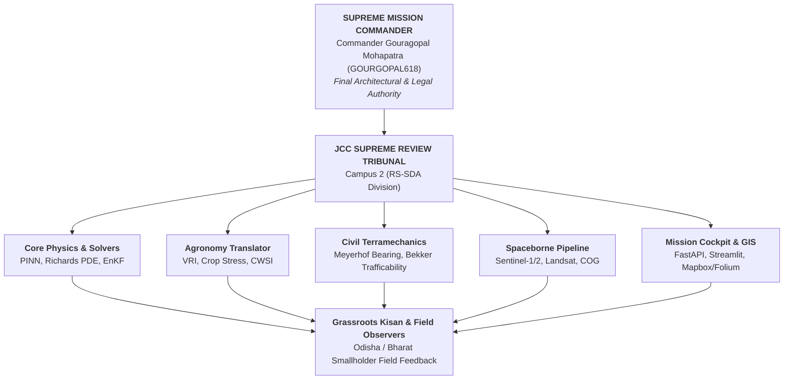
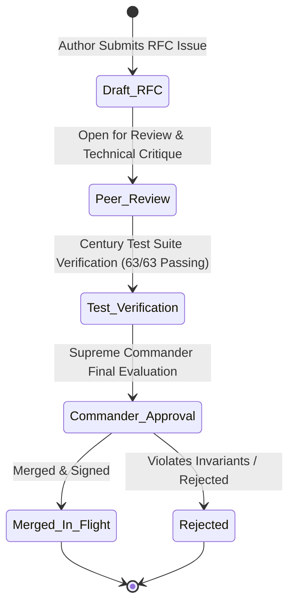

# JAGANNATH COMMAND CENTER (JCC) — SOVEREIGN PROJECT GOVERNANCE & ARCHITECTURAL CHARTER (JCC-GOV-v1.0)

<div align="center">


<br/>

[-00f2fe?style=for-the-badge&logo=spacex&logoColor=00f2fe&labelColor=050814)](#-2-organizational-hierarchy--command-structure)
[-7f00ff?style=for-the-badge&logo=nasa&logoColor=7f00ff&labelColor=050814)](#-2-organizational-hierarchy--command-structure)
[](#-1-governance-philosophy--core-tenets)
[](#-5-release-lifecycle--flight-certification)

<br/>

> **Dedicated with profound reverence to the Lotus Feet of Mahaprabhu Shri Jagannath.**  
> *Sovereign Sanctum: Balasore / Bhadrak Border Sanctum, Odisha, Bharat.*

</div>

---

## 🏛️ 1. GOVERNANCE PHILOSOPHY & CORE TENETS

The governance of **THE MRIDANSH** and its computational core **AETHER-MRID1607X** is structured under the **Benevolent Sovereign Stewardship Model**, anchored in the aerospace tradition of Mission Command and Bharatiya **Technological Dharma**.

Unlike diffuse or corporate-monopolized open source initiatives, this project is guided by three non-negotiable architectural axioms:
1. **Grassroots Kisan Priority:** Algorithmic development must directly empower smallholder farmers, prevent agricultural distress, optimize irrigation water, and safeguard lives. Commercial paywalls against farmers are permanently forbidden.
2. **Aerospace Determinism (DO-178C Level-A):** Decisions are bound by physical conservation laws, rigorous numerical invariants, and reproducible verification harnesses. Technical consensus cannot override empirical physics.
3. **Sovereign Technological Integrity:** The architecture, neural weights, and domain translators remain protected under [LICENSE.md](LICENSE.md) (`JSTIRPL-v1.0`), preventing corporate SaaS hijacking, model distillation, and weaponization.

---

## 🎖️ 2. ORGANIZATIONAL HIERARCHY & COMMAND STRUCTURE



### 2.1 Supreme Mission Commander & Chief Architect
- **Incumbent:** **Commander Gouragopal Mohapatra (`GOURGOPAL618`)**
- **Responsibilities:**
  - Supreme architectural stewardship over system blueprints, algorithms, and neural models.
  - Final decision on all Pull Requests, Request for Comments (RFCs), and architectural pivots.
  - Stewardship and legal enforcement of the sovereign license (`JSTIRPL-v1.0`).
  - Flight readiness certification and official cryptographic releases.

### 2.2 Subsystem Flight Leads & Maintainers
Maintainers are designated domain specialists who oversee specific technical portfolios:
- **Core Physics & Numerical State Estimation:** Maintains Richards equation finite difference/PINN solvers, Saxton-Rawls pedotransfer models, and Ensemble Kalman Filter (EnKF) assimilation loops.
- **Agronomy Domain Translators:** Oversees crop water stress metrics ($K_s, \text{CWSI}$), Variable-Rate Irrigation (VRI) optimization, and root-zone water balance.
- **Civil & Geotechnical Translators:** Oversees Meyerhof ultimate bearing capacity, DEM slope stability, and Bekker terramechanics trafficability.
- **Spaceborne Data Pipeline & STAC Services:** Oversees Copernicus Sentinel-1 SAR GRD, Sentinel-2 MSI, ISRO Bhuvan, Landsat-9, and Cloud-Optimized GeoTIFF (COG) ingestion.
- **Mission Cockpit & Interactive GIS:** Oversees FastAPI endpoints, Streamlit cockpit dashboards, and raster overlay renderers.

### 2.3 Peer Researchers & Academic Observers
Bona fide scientists, agronomists, and university scholars who audit source code, verify mathematical proofs, and submit independent validation dossiers.

### 2.4 Grassroots Farmer Liaisons (*Kisan Representatives*)
Farmer cooperatives, primary agricultural societies, and field extension workers who provide ground-truth observations from farm fields across Odisha and Bharat.

---

## 🗳️ 3. DECISION-MAKING PROCESS & RFC ARCHITECTURE

Major architectural enhancements, numerical parameter changes, or interface modifications must follow the **JCC Request For Comments (RFC)** protocol:



### 3.1 Decision Tiers
1. **Tier 1 — Minor Bug Fixes & Doc Updates:** Approved by Subsystem Maintainer and merged upon passing all 63 test suites.
2. **Tier 2 — Subsystem Logic & Feature Additions:** Requires Maintainer sign-off, full 63/63 test pass, and Supreme Commander approval.
3. **Tier 3 — Core Physics, Boundary Invariants & Licensing:** Solely within the jurisdiction of Commander Gouragopal Mohapatra.

### 3.2 Immutable Constraints (Non-Negotiable Invariants)
No consensus, majority vote, or pull request can relax or remove:
- The mass conservation residual threshold ($< 10^{-6}\ \text{m}^3/\text{m}^3$) in the Richards solver.
- The minimum factor of safety ($\text{FS} \ge 1.30$) for heavy tractor mobility.
- The complementary stress identity ($K_s + \text{CWSI} \equiv 1.000000$).
- The free public benefit exemption for smallholder farmers under [LICENSE.md](LICENSE.md).

---

## 📜 4. CONFLICT RESOLUTION & ESCALATION

If technical or architectural disagreements arise between contributors and maintainers:
1. **Empirical Benchmarking First:** Disagreements must be tested using empirical telemetry and Monte Carlo simulations. The solution demonstrating lower numerical error and higher physical stability is preferred.
2. **Commander Arbitrament:** If consensus cannot be achieved, Commander Gouragopal Mohapatra will issue a definitive, binding architectural ruling based on DO-178C Level-A safety standards.
3. **Zero Toxicity Policy:** Personal attacks or bad-faith obstruction will result in disciplinary escalation under [CODE_OF_CONDUCT.md](CODE_OF_CONDUCT.md).

---

## 🚀 5. RELEASE LIFECYCLE & FLIGHT CERTIFICATION

### 5.1 Flight Readiness Cadence
Releases undergo formal validation before receiving the **TRL-7 OPERATIONAL** designation:

```
[Local Engineering] ──▶ [Century Audit 63/63] ──▶ [Monte Carlo PMC-1000] ──▶ [SHA-256 Provenance Lock] ──▶ [Commander Flight Tag]
```

1. **Century Test Audit:** All 63 verification files and 426 contracts must achieve a 100.0% pass rate.
2. **Planetary Monte Carlo Stress Test (PMC-1000):** 1,000 extreme climate trials across 4 quadrants (Drought, Deluge, Sensor Dropout, Liquefaction) must achieve zero mass drift and zero NaN divergence.
3. **Cryptographic Checksum Seal:** All neural weights, configuration schemas, and production COG rasters are hashed with SHA-256.
4. **Target Flight Lock:** Scheduled for **14 November 2026 @ 18:18:00 IST (`v1.0.0-TRL7-OPERATIONAL`)**.

---

## 🏛️ 6. LEGAL JURISDICTION & AMENDMENTS

Amendments to this Governance Charter may be enacted solely by Commander Gouragopal Mohapatra. This charter is governed by the laws of the **Republic of Bharat (India)** under the exclusive jurisdiction of **The High Court of Orissa, Cuttack, Bharat**.

---

<div align="center">

```
╔══════════════════════════════════════════════════════════════════════════════════════╗
║                                                                                      ║
║                 JCC SOVEREIGN GOVERNANCE & ARCHITECTURAL SEAL                        ║
║                                                                                      ║
║                 COMMANDER GOURAGOPAL MOHAPATRA (GOURGOPAL618)                        ║
║            Lead Systems Architect & Remote Sensing Mission Engineer                  ║
║           JAGANNATH COMMAND CENTER (JCC) - CAMPUS 2 (RS-SDA DIVISION)                ║
║                                                                                      ║
║             Sovereign Sanctum: Balasore / Bhadrak Border Sanctum,                    ║
║                               Odisha, Bharat                                         ║
║                                                                                      ║
║         Target Flight Release Lock: 14 November 2026 @ 18:18:00 IST                  ║
║                                                                                      ║
║           DEDICATED TO THE LOTUS FEET OF MAHAPRABHU SHRI JAGANNATH                   ║
║                                                                                      ║
╚══════════════════════════════════════════════════════════════════════════════════════╝
```

[-00f2fe?style=for-the-badge&logo=shield&logoColor=00f2fe&labelColor=050814)](#-1-governance-philosophy--core-tenets)
[](#-5-release-lifecycle--flight-certification)

</div>
