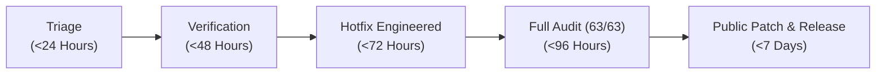

# JAGANNATH COMMAND CENTER (JCC) — SOVEREIGN SECURITY POLICY & VULNERABILITY DISCLOSURE CHARTER (JCC-SEC-v1.0)

<div align="center">


<br/>

[-00f2fe?style=for-the-badge&logo=spacex&logoColor=00f2fe&labelColor=050814)](#-1-security-charter--mission-scope)
[-7f00ff?style=for-the-badge&logo=nasa&logoColor=7f00ff&labelColor=050814)](#-1-security-charter--mission-scope)
[](#-3-threat-model--system-boundaries)
[](#-4-reporting-a-security-vulnerability)

<br/>

> **Dedicated with profound reverence to the Lotus Feet of Mahaprabhu Shri Jagannath.**  
> *Sovereign Sanctum: Balasore / Bhadrak Border Sanctum, Odisha, Bharat.*

</div>

---

## 🛰️ 1. SECURITY CHARTER & MISSION SCOPE

**THE MRIDANSH** and its computational core **AETHER-MRID1607X** operate as a mission-critical, physics-guided Earth observation digital twin. The system processes spaceborne radar (Copernicus Sentinel-1 SAR), optical multispectral imagery (Sentinel-2, Landsat-9, ISRO Bhuvan), and numerical terrain models (SRTM DEM, ERA5 agrometeorological reanalysis) to generate safety-critical agronomic and terramechanical telemetry.

Because smallholder farmers rely on this intelligence for crop survival, flood risk, and tractor sinkage prevention, **cybersecurity, numerical integrity, and tamper-resistance are treated as aerospace flight-safety imperatives (DO-178C Level-A assurance)**.

---

## 🛡️ 2. SUPPORTED FLIGHT BASELINES & RELEASES

Only official, cryptographically sealed releases engineered by the Jagannath Command Center are eligible for security maintenance and vulnerability patching:

| Baseline Version | Flight Status | Release Date | Security Maintenance |
| :--- | :---: | :---: | :---: |
| **`v1.0.0-TRL7-OPERATIONAL`** | 🚀 **Active Flight Baseline** | **14 Nov 2026** | **FULL ACTIVE SUPPORT (Patches & Hotfixes)** |
| **`v0.7.0-TRL7`** | 🔒 Legacy Frozen Core | 09 Nov 2026 | Critical Numerical Security Fixes Only |
| **`< v0.7.0` (Alpha/Dev)** | ⛔ Deprecated / Sunset | Prior | End of Life (Upgrade to TRL-7 Mandatory) |

---

## ⚔️ 3. THREAT MODEL & SYSTEM BOUNDARIES

Security assessments and audits focus on four primary attack surfaces:

### 3.1 Spaceborne Pipeline & STAC Ingestion Security
- **Untrusted Remote Raster Injection:** Ingestion of malicious Cloud-Optimized GeoTIFF (COG), GeoTIFF headers, or corrupted HDF5/NetCDF files designed to exploit GDAL/Rasterio buffer overruns.
- **Server-Side Request Forgery (SSRF):** Exploitation of satellite endpoint routers or STAC API proxies to probe internal networks.
- **Data Tampering & Spoofing:** Man-in-the-middle manipulation of satellite reflectance or backscatter telemetry to trigger false drought or flood emergencies.

### 3.2 Physics Engine & Neural Weight Tampering
- **Adversarial Perturbation:** Injection of imperceptible gradient noise into radar backscatter tensors ($\sigma_{VV}^0, \sigma_{VH}^0$) to corrupt physics-informed soil moisture estimates.
- **Numerical Poisoning:** Deliberate falsification of Richards equation mass conservation boundaries ($< 10^{-6}$) or Saxton-Rawls pedotransfer matric suction limits.
- **Weight Corruption:** Tampering with serialized PyTorch model weights or Kalman covariance matrices ($P_{t|t}$) to induce filter divergence. All production weights are locked with SHA-256 provenance checksums.

### 3.3 Geotechnical & Civil Safety Protection
- **Terramechanics Invariant Enforcement:** Attempts to manipulate Meyerhof bearing capacity or Bekker sinkage equations ($\text{FS} \ge 1.30$) to falsely certify dangerous quagmires or liquefying terrain as passable.
- **Complementary Stress Identity Validation:** Continuous assertion that $K_s + \text{CWSI} \equiv 1.000000$ to prevent computational panic or silent NaN propagation.

### 3.4 FastAPI Backend & GIS Cockpit Security
- **API Defense:** Rate limiting, strict Pydantic v2 bounding box coordinate validation (WGS84 EPSG:4326), and sanitized query parameter parsing.
- **Denial of Service (DoS):** Protection of GPU tensor allocation and Latin Hypercube Monte Carlo engines against algorithmic complexity exhaustion attacks.

---

## 🚨 4. REPORTING A SECURITY VULNERABILITY

We deeply appreciate responsible, ethical security researchers who help protect our sovereign infrastructure. If you discover a security vulnerability or numerical integrity defect:

### 4.1 Transmission Protocol
**DO NOT file a public GitHub issue or discuss the vulnerability publicly.**

Please transmit an encrypted or private report directly to Supreme Mission Command:
- **Lead Contact:** Commander Gouragopal Mohapatra (`GOURGOPAL618`)
- **Direct Email:** [`ggmohapatra.info.2007@gmail.com`](mailto:ggmohapatra.info.2007@gmail.com)
- **Subject Format:** `[SECURITY-ADVISORY-JCC] <Subsystem> - <Severity (Critical/High/Medium/Low)>`

### 4.2 Report Requirements
To accelerate verification, please include:
1. **Affected Component:** Specific file, endpoint (`/predict`, `/gis/layer`), pipeline ingestor, or tensor transformation.
2. **Threat Assessment:** Description of the exploit vector, potential real-world impact on farmers or civil operators.
3. **Proof-of-Concept (PoC):** Minimal reproducible script, mock tensor, or HTTP request payload.
4. **Environment Details:** OS, Python version, GDAL version, and commit SHA.

---

## ⏱️ 5. INCIDENT RESPONSE SERVICE LEVEL AGREEMENT (SLA)

The Jagannath Command Center follows a disciplined aerospace incident response timeline:



| Phase | Aerospace SLA | JCC Operational Protocol |
| :---: | :---: | :--- |
| **Initial Triage** | **Within 24 Hours** | Formal receipt acknowledgment and assignment of Incident ID. |
| **Exploit Verification** | **Within 48 Hours** | Reproduction of the defect in an isolated sandbox environment. |
| **Hotfix & Patch Engineering** | **Within 72 Hours** | Engineering patch developed, preserving all physical invariants. |
| **Verification & Regression Audit** | **Within 96 Hours** | Complete 63-file test suite execution (100% pass mandate). |
| **Public Patch Release** | **Within 7 Days** | Coordinated security advisory and signed tag release on GitHub. |

---

## 🤝 6. SOVEREIGN SAFE HARBOR POLICY

The Jagannath Command Center considers good-faith security research to be an honorable service to society. We pledge that:
- **No Legal Action:** JCC will **not** initiate legal proceedings or copyright claims against researchers who conduct testing in compliance with this policy.
- **Fair Investigation:** We will collaborate transparently with you to understand and resolve the issue.
- **Public Recognition:** Researchers who discover and responsibly disclose verified vulnerabilities will be honored in the **JCC Security Hall of Fame**.

### ⚠️ Safe Harbor Boundaries (Prohibited Actions):
- Testing against active field-deployed irrigation systems or live farm advisory channels.
- Causing denial of service (DoS) on public-facing JCC web services.
- Exfiltrating, publishing, or altering sensitive ground-truth telemetry or personal farmer data.
- Violating the anti-commercial or anti-weaponization clauses of [LICENSE.md](LICENSE.md).

---

## 🏛️ 7. SOVEREIGN GOVERNANCE & JURISDICTION

This Security Policy is governed by the laws of the **Republic of Bharat (India)** under the sovereign jurisdiction of the **High Court of Orissa, Cuttack, Bharat**.

---

<div align="center">

```
╔══════════════════════════════════════════════════════════════════════════════════════╗
║                                                                                      ║
║                       JCC CYBERDEFENSE & SECURITY SEAL                               ║
║                                                                                      ║
║                 COMMANDER GOURAGOPAL MOHAPATRA (GOURGOPAL618)                        ║
║            Lead Systems Architect & Remote Sensing Mission Engineer                  ║
║           JAGANNATH COMMAND CENTER (JCC) - CAMPUS 2 (RS-SDA DIVISION)                ║
║                                                                                      ║
║             Sovereign Sanctum: Balasore / Bhadrak Border Sanctum,                    ║
║                               Odisha, Bharat                                         ║
║                                                                                      ║
║         Target Flight Release Lock: 14 November 2026 @ 18:18:00 IST                  ║
║                                                                                      ║
║           DEDICATED TO THE LOTUS FEET OF MAHAPRABHU SHRI JAGANNATH                   ║
║                                                                                      ║
╚══════════════════════════════════════════════════════════════════════════════════════╝
```

[-00f2fe?style=for-the-badge&logo=shield&logoColor=00f2fe&labelColor=050814)](#-1-security-charter--mission-scope)
[](#-3-threat-model--system-boundaries)

</div>
